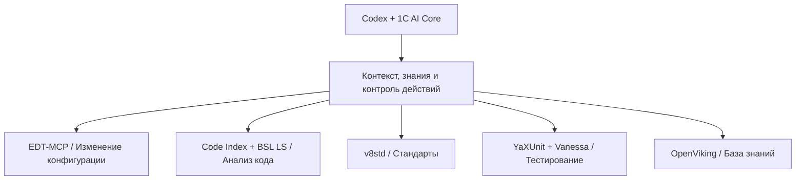

# 1C AI Core

Плагин для AI-разработки и сопровождения проектов 1С в Codex. Объединяет поиск и анализ кода, изменение объектов конфигурации через EDT, проверку стандартов, ревью изменений и автоматизированное тестирование с YaXUnit и Vanessa Automation.

Реализует подход к разработке на основе контекста проекта, проверенных знаний и контролируемых действий AI-агента. Перед выполнением изменений учитываются существующие механизмы, применимость решений, стандарты разработки и ограничения безопасности.

Поддерживает интеграцию с EDT-MCP, Code Index, BSL Language Server, v8std и базой знаний OpenViking. Позволяет работать с разными проектами через индивидуальные профили `.ai/project.yaml`.



## Установка

Для работы с плагином нужны настольный Codex с локальным выполнением и
Node.js 22+ в `PATH`. JS-зависимости входят в пакет.
EDT-MCP и v8std запускаются отдельно. Плагин подготавливает индекс кода
и, по желанию, BSL Language Server, для которого нужна совместимая Java.

### Через интерфейс Codex (рекомендуется)

1. В настольном Codex откройте **Плагины**. В меню **Добавить** выберите
   добавление маркетплейса.
2. В окне **Добавить маркетплейс плагинов** вставьте адрес магазина
   в поле **Источник**.

   ```text
   https://github.com/ShadobaAI/codex-plugins
   ```

   Оставьте поля **Git ref** и **Выборочные пути** пустыми и нажмите
   **Добавить маркетплейс**.
3. Если открыт экран управления плагинами, нажмите **Просмотреть каталог**.
   В каталоге перейдите на вкладку **Личные**.
4. В разделе **ShadobaAI** нажмите **+** рядом с **1C AI Core** (стабильная
   версия) или **1C AI Core Preview** (сборки из `develop`).

### Через Codex CLI

Добавьте магазин и установите стабильную версию.

```sh
codex plugin marketplace add https://github.com/ShadobaAI/codex-plugins.git
codex plugin add 1c-ai-core@shadobaai
```

Для предварительных сборок из `develop` после добавления магазина выполните
`codex plugin add 1c-ai-core-preview@shadobaai`.
Синтаксис команд описан в [справочнике Codex CLI](https://learn.chatgpt.com/docs/cli/reference#codex-plugin).

### После установки

1. В настольном Codex откройте папку своего проекта 1С и начните новый чат
   с установленным плагином.
2. Напишите **«Помоги настроить 1C AI Core для этого проекта»**.
   Агент поможет создать профиль, сопоставить репозитории с проектами EDT
   и указать адреса EDT-MCP и v8std.
3. Разрешите подготовку нужных компонентов и запустите проверку готовности проекта.

## v8std

v8std предоставляет нормативные материалы и базу знаний для разработки 1С:

- [zeegin/v8std](https://github.com/zeegin/v8std) — исходный проект, основа.
- [ShadobaAI/v8std](https://github.com/ShadobaAI/v8std) — форк автора 1C AI Core
  с базой знаний по Vanessa и YaXUnit. Рекомендуется использовать этот форк.
- [aleksp99/v8std-mcp](https://hub.docker.com/r/aleksp99/v8std-mcp) — готовый
  Docker-образ автора 1C AI Core, собранный из
  [ShadobaAI/v8std](https://github.com/ShadobaAI/v8std), с базой знаний по
  Vanessa и YaXUnit.

Сервер v8std запускается отдельно; его MCP URL указывается в настройках плагина.
Подключая публичный или локальный v8std, пользователь разрешает его операции,
включая передачу кода и контекста задачи; дополнительных согласий на работу с
этим сервером плагин не запрашивает. Решения среды об одобрении и разрешения на
самостоятельные действия с проектом действуют отдельно.

## Настройка и работа

Попросите **«Открой настройки проекта 1C AI Core»** в чате или откройте
**«Настройки»** через карточку плагина. Из чата форма привязана к его проекту;
общая форма показывает список известных профилей.

Профиль — `.ai/project.yaml` в вашем проекте: какие репозитории использовать,
где исходники и какой EDT-проект ими управляет. Личные адреса подключений
сохраняйте в локальных настройках. Поставляется универсальный шаблон `generic-1c`;
профиль конкретной конфигурации создаётся в её репозитории.

После настройки можно попросить: «Найди реализацию…», «Внеси изменение…»,
«Проведи ревью ветки…», «Добавь тест YaXUnit…». Запуск тестов требует
соответствующего окружения и настройки профиля.

База знаний OpenViking помогает находить готовые механизмы и проверенный опыт.
Плагин поддерживает режимы знаний, проверки допуска рабочих процессов и клиентский MCP-адаптер;
публикация, права сервера и live-приёмка проверяются отдельно. Отдельный MCP
информационной базы в плагин не входит. Подробности — в
[документации по интеграциям](docs/INTEGRATIONS.md).
Локальные регрессии и поведенческие сценарии описаны в
[локальных проверках](docs/ACCEPTANCE.md); они не подтверждают полную KORA-готовность.

- [Настройка, обновления и диагностика](docs/USAGE.md)
- [Создание и устройство профиля](docs/PROFILES.md)
- [AGENTS.md своего проекта](docs/PROJECT_AGENTS.md)
- [Требования и ограничения](docs/REQUIREMENTS.md)
- [Требования к качеству решений](docs/QUALITY_REQUIREMENTS.md)
- [Вся документация](docs/README.md)

## Разработчику

Корень репозитория совпадает с корнем Node.js-плагина. Для изменения самого
плагина EDT не требуется. Нужны Node.js 22+, npm и Git.

```sh
git clone https://github.com/ShadobaAI/edt-ai-core.git
cd edt-ai-core
npm ci --ignore-scripts
node tools/vendor.mjs
node tools/test.mjs
```

Локальная сборка через [build-plugin.sh](https://github.com/ShadobaAI/edt-ai-core/blob/main/tools/build-plugin.sh)
(на Windows — в Git Bash):

```sh
bash tools/build-plugin.sh
```

Без Bash выполните те же действия напрямую:

```sh
node tools/vendor.mjs
node tools/package-plugin.mjs
```

Результат — `.build/marketplace/` и два ZIP в `.build/`: плагин и магазин.
Для локальной установки зарегистрируйте готовый магазин:

```sh
codex plugin marketplace add ./.build/marketplace
```

Установите **1C AI Core** из этого источника в каталоге плагинов.
Сборка заменяет предыдущую `.build/` и ничего не публикует.
Проверка пакета и выпуск описаны в [руководстве разработчика](docs/DEVELOPMENT.md).

## Лицензия

Код, навыки и документация 1C AI Core распространяются под
[Mozilla Public License 2.0](LICENSE). Авторство и сведения о сторонних
компонентах — в [NOTICE.md](NOTICE.md); сторонние компоненты сохраняют
собственные лицензии. Лицензия Unicode-данных включена в
[UNICODE-LICENSE.txt](UNICODE-LICENSE.txt), лицензии встроенных Node-зависимостей
собираются в `vendor/NOTICE.txt`.
