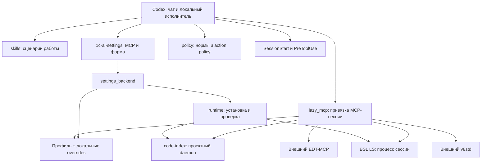

# Техническая архитектура

1C AI Core — локальный Node.js ESM-плагин. Codex загружает навыки, MCP-серверы
и hooks из пакета; профили связывают их с выбранным проектом 1С.
Плагин не содержит платформу 1С, EDT, Java или работающий сервер v8std.

## Состав и границы

Для OpenViking реализованы режимы знаний и workflow gates; поисковый адаптер
и MCP ИБ планируются. Их место в потоке данных и границы описаны
в [INTEGRATIONS.md](INTEGRATIONS.md).

| Модуль | Ответственность |
| --- | --- |
| `plugin.json` | Метаданные, требование локального исполнителя, onboarding skill и hooks |
| `mcp.json` | Шесть stdio-входов: policy, настройки, code-index, bsl-ls, edt, v8std |
| `skills/` | Настройка, routing, изменение кода, поиск, нормы, диагностика, ревью и тесты |
| `scripts/profile.mjs`, `schemas/` | Загрузка, валидация, создание и перенос профиля |
| `scripts/selection.mjs`, `project_paths.mjs` | Выбранный каталог, поиск профиля, containment, namespace проекта/экземпляра |
| `scripts/project_context.mjs` | Effective-настройки с учётом overrides и окружения |
| `scripts/directory_context.mjs` | Ограниченный discovery EDT-контекста из файлов проекта/workspace |
| `mcp/settings.mjs`, `ui/settings.html` | MCP App, глобальный и проектный входы в форму |
| `scripts/settings_backend.mjs` | Единая логика записи, preview/apply, подготовки и импорта/экспорта |
| `mcp/settings-operations.mjs` | Операции с ID, наблюдение результата, защита от повторного запуска |
| `scripts/runtime.mjs` | Releases, загрузки, integrity, запуск, smoke и обновления managed-компонентов |
| `scripts/lazy_mcp.mjs` | Ленивое подключение, контекст сессии, forwarding живого MCP API |
| `mcp/bsl-ls-proxy.mjs` | Маршрутизация BSL LS с native multi-workspace API |
| `scripts/setup_probe.mjs`, `setup_readiness.mjs` | Внешние пробы, составная готовность и её устаревание |
| `policy/`, `scripts/guard.mjs`, `hooks/` | Нормативные проверки, action policy, границы источников |
| `vanessa/`, `scripts/vanessa.mjs` | Профильный CLI/manager Vanessa, сессии и receipts |
| `scripts/diagnostics.mjs`, `support_bundle.mjs` | Ограниченный журнал и локальный support report |
| `scripts/package_layout.mjs`, `tools/` | Состав поставки, bundle зависимостей, ZIP и выпуск |

## Выбор проекта и изоляция

MCP-соединение получает каталог через окружение, host roots или стартовую
директорию. Когда хост не передал каталог, явный `projectRoot` может привязать
невыбранную сессию. Ошибку/неоднозначность host roots нужно разрешить на стороне
Codex; аргумент не подменяет уже закреплённый другой каталог.

После выбора загружается `.ai/project.yaml`, проверяется схема, совместимость
ядра и относительные пути. Затем накладываются локальные и instance-настройки.
Подробный порядок — в [PROFILES.md](PROFILES.md#подключения-и-экземпляры).

Сохранённый `active_project` и история настроек не выбирают проект другого чата.
Settings App и каждый relay имеют собственную привязку. Смена effective binding
закрывает зависимое подключение этой сессии и обновляет её набор инструментов.
Параллельные проекты не переключаются глобально.

Файлы состояния разделены по нормализованному реальному пути проекта
и `EDT_AI_INSTANCE`. Владение namespace проверяется; миграция старого
case-folded namespace использует подтверждённого владельца. Отдельная клиентская
сессия не изолирует общий сервер EDT: независимым контурам нужны свои endpoints.

## Подключение MCP

При старте relay предоставляет управляющий статус. Он не скачивает все runtime
из-за самого `tools/list`. Подключение требует валидного профиля, включённого
компонента и, для managed runtime, разрешённой подготовки.

`core_runtime_status` позволяет проверить и привязать нужную сессию.
В начальном наборе также есть `core_runtime_tools` и `core_runtime_call`: они
дают доступ к живым схемам и native-вызовам, когда хост сохраняет начальный
каталог и не раскрывает новые инструменты после уведомления. Первый принимает
необязательный фильтр `names`; второй — от 1 до 16 последовательных `calls`
с native `name` и `arguments`. Каждый вызов проверяется по живой JSON Schema,
сохраняет ограничения alias/path и требует обычного разрешения своих эффектов.
Source guard раскрывает envelope и проверяет каждый supplied alias.
Оба инструмента принимают `projectRoot` при пустых host roots без смены чужой
привязки. Группа выполняется в одном соединении, останавливается на первой
ошибке и сохраняет предыдущие результаты; автоматического повтора и отката нет.
После подключения relay получает живые инструкции, capabilities и страницы
списка инструментов, передаёт вызовы серверу, отслеживает изменения списка.
Это позволяет выбирать операции по фактическому API без встроенного перечня
версий EDT/v8std и без копирования всей документации сервера в навыки.

EDT и v8std доступны через HTTP MCP-клиент. Настройки поддерживают таймаут,
ограничение размера ответа и HTTP-заголовки через ссылки на environment.
В URL запрещены credentials, fragment, неподдерживаемая схема и некорректный порт.

## Managed runtime

**Code-index:** плагин скачивает нативный артефакт подходящей платформы,
проверяет размер и SHA-256 release asset, подготавливает mapping репозиториев,
запускает daemon проекта и read-only stdio-клиентов. Проверяется здоровье
и готовность индекса; наличие процесса не доказывает полноту покрытия.

**BSL LS:** скачивается executable JAR. Node-proxy владеет процессом своей
stdio-сессии. Пути workspace предоставляет назначенный EDT, несколько workspace
регистрируются native API. Проверка контракта обязательна; fallback через
подмену единственного workspace отсутствует. Java предоставляет пользователь.

Можно назначить компоненту `mode: external` и URL вместо managed-запуска.
Версия `latest` означает стабильный upstream; prerelease выбирается явно.
Кандидат обновления хранится отдельно, применение проверяет live-протокол,
доступен откат к предыдущему артефакту. Контракт:
[runtime-manifest.yaml](../runtime/runtime-manifest.yaml).

## Настройки и проверка готовности

`settings.inspect` возвращает компактный snapshot без запуска сервисов.
`settings.probe_connections` проверяет назначенные внешние endpoints.
`settings.run_check` с разрешённым scope подготавливает включённые компоненты,
проверяет policy, внешние MCP и состав файлов плагина.

Долгие операции выполняются через registry операций с ID; клиент запрашивает
результат уже начатой операции. Preview/import/edit используют revision,
чтобы не перезаписать параллельное изменение. Записи проверяются схемами;
профиль перед заменой резервируется, связанные настройки восстанавливаются
при ошибке записи.

Readiness receipt содержит время, проверки и fingerprint конфигурации, профиля,
runtime lock, EDT-контекста, hooks/skills и проектных инструкций. Срок — 15 минут;
изменение входов инвалидирует результат. Полнота содержания AGENTS.md, фактическая
активация hooks и успешность прикладных операций этим механизмом не доказываются.

## Policy, навыки и guard

Bundled policy предоставляет локальный нормативный реестр и протокол проверки
ledger. Он сопоставляет заявленные требования и evidence, но не подтверждает
истинность текста источника и не выдаёт разрешение от имени пользователя.
Живой v8std поставляет нормативный текст, навыки определяют применимость.

Action policy отдельно проверяет scope и эффекты `cleanup`, `launch`, `database`,
`remote_git`. Общее назначение изменить код не расширяется до разрешения
перезапустить приложение или изменить ИБ. Уже выданное разрешение сохраняет
силу в той же области. См. [общий контракт](../skills/1c-routing/references/action-policy.md).

SessionStart загружает контекст профиля, PreToolUse проверяет protected/source
paths и индексные aliases. Guard дополняет sandbox и навыки; он не является
анализатором произвольного shell-кода. Регистрация hook в manifest и наличие
его файла не доказывают включение хостом.

## Поставка и состояние

Сборщик берёт allowlist из `scripts/package_layout.mjs`, добавляет совместимый
`.codex-plugin/plugin.json`, `build-info.json`, `SOURCE.md` и каталог магазина.
Vendor bundle включает JS-библиотеки и готовые Windows-модули Koffi.
Dev-зависимости, тесты, инструменты сборки, Git и локальное состояние в ZIP
не входят. Детали — в [DEVELOPMENT.md](DEVELOPMENT.md).

Состояние по умолчанию хранится в `~/.codex/1c-ai-core`, отдельно от кэша
установленного плагина. Обновление пакета не требует копировать туда профили
проектов или credentials. Журналы и экспорт диагностики остаются локальными.
