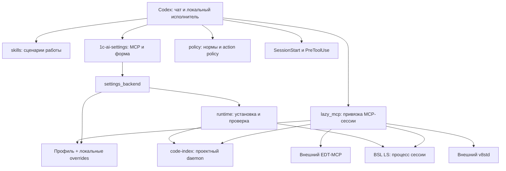

# Техническая архитектура

1C AI Core — локальный Node.js ESM-плагин. Codex загружает навыки, MCP-серверы
и hooks из пакета; профили связывают их с выбранным проектом 1С.
Плагин не содержит платформу 1С, EDT, Java или работающий сервер v8std.

## Состав и границы

Плагин поддерживает режимы знаний, проверки допуска рабочих процессов и клиентский адаптер OpenViking.
Публикация знаний и права сервера проверяются отдельно; MCP информационной базы
в плагин не входит. Границы описаны в [INTEGRATIONS.md](INTEGRATIONS.md).

| Модуль | Ответственность |
| --- | --- |
| `plugin.json` | Метаданные, требование локального исполнителя и hooks |
| `mcp.json` | Семь stdio-входов: policy, настройки, code-index, bsl-ls, edt, v8std, openviking |
| `skills/` | Настройка, routing, изменение кода, поиск, нормы, диагностика, ревью и тесты |
| `scripts/profile.mjs`, `schemas/` | Загрузка, валидация, создание и перенос профиля |
| `scripts/selection.mjs`, `project_paths.mjs` | Выбранный каталог, поиск профиля, containment, namespace проекта/экземпляра |
| `scripts/project_context.mjs` | Effective-настройки с учётом overrides и окружения |
| `scripts/directory_context.mjs` | Ограниченный discovery EDT-контекста из файлов проекта/workspace |
| `mcp/settings.mjs`, `ui/settings.html` | MCP App, глобальный и проектный входы в форму |
| `scripts/settings_backend.mjs` | Единая логика записи, preview/apply, подготовки и импорта/экспорта |
| `mcp/settings-operations.mjs` | Операции с ID, наблюдение результата, защита от повторного запуска |
| `scripts/runtime.mjs` | Releases, загрузки, integrity, запуск, smoke и обновления managed-компонентов |
| `scripts/lazy_mcp.mjs` | Ленивое подключение, контекст сессии, forwarding живого MCP API |
| `mcp/bsl-ls-proxy.mjs` | Маршрутизация BSL LS с native multi-workspace API |
| `scripts/setup_probe.mjs`, `setup_readiness.mjs` | Внешние пробы, составная готовность и её устаревание |
| `policy/`, `scripts/guard.mjs`, `hooks/` | Нормативные проверки, action policy, границы источников |
| `vanessa/`, `scripts/vanessa.mjs` | Профильный CLI/manager Vanessa, сессии и receipts |
| `scripts/diagnostics.mjs`, `support_bundle.mjs` | Ограниченный журнал и локальный support report |
| `scripts/package_layout.mjs`, `tools/` | Состав поставки, bundle зависимостей, ZIP и выпуск |

## Выбор проекта и изоляция

MCP-соединение получает каталог через окружение, host roots или стартовую
директорию. Когда хост не передал каталог, явный `projectRoot` может привязать
невыбранную сессию. Ошибку/неоднозначность host roots нужно разрешить на стороне
Codex; аргумент не подменяет уже закреплённый другой каталог.

После выбора загружается `.ai/project.yaml`, проверяется схема, совместимость
ядра и относительные пути. Затем накладываются локальные и instance-настройки.
Подробный порядок — в [PROFILES.md](PROFILES.md#подключения-и-экземпляры).

Сохранённый `active_project` и история настроек не выбирают проект другого чата.
Settings App и каждый relay имеют собственную привязку. Смена effective binding
закрывает зависимое подключение этой сессии и обновляет её набор инструментов.
Параллельные проекты не переключаются глобально.

Файлы состояния разделены по нормализованному реальному пути проекта
и `EDT_AI_INSTANCE`. Владение namespace проверяется. При обнаружении несовместимой
области состояния запуск блокируется. Проверьте владельца указанного каталога,
остановите принадлежащие ему сервисы и переместите состояние в архив вне рабочего
каталога состояния. Плагин не переносит и не удаляет состояние автоматически. Отдельная клиентская
сессия не изолирует общий сервер EDT: независимым контурам нужны свои endpoints.

## Подключение MCP

Relay всегда возвращает управляющие инструменты в `tools/list`, не дожидаясь
ответа roots или удалённого сервера. Подключение начинается при
вызове управляющего инструмента и требует валидного профиля, включённого
компонента и, для managed runtime, разрешённой подготовки.

`core_runtime_status` позволяет проверить и привязать нужную сессию.
В начальном наборе также есть `core_runtime_tools` и `core_runtime_call`: они
дают доступ ко всем живым схемам и native-вызовам без раскрытия внешнего
каталога в постоянном наборе инструментов хоста. Первый принимает режим
`detail: "names"` для поиска имён и необязательный фильтр `names` для схем;
второй — от 1 до 16 последовательных `calls`
с native `name` и `arguments`. Каждый вызов проверяется по живой JSON Schema,
сохраняет ограничения alias/path и требует обычного разрешения своих эффектов.
Поддерживаются схемы без указанного dialect (2020-12), draft-06, draft-07,
2019-09 и 2020-12; неизвестный dialect отклоняется до вызова сервера.
Source guard раскрывает envelope и проверяет каждый supplied alias.
Оба инструмента принимают `projectRoot` при пустых host roots без смены чужой
привязки. Группа выполняется в одном соединении, останавливается на первой
ошибке и сохраняет предыдущие результаты; автоматического повтора и отката нет.
После подключения relay получает живые инструкции, capabilities и страницы
списка инструментов, передаёт вызовы серверу, отслеживает изменения списка.
При отсутствии выбранного проекта списки ресурсов и подсказок пусты; ошибки
подключённого сервера и ограничения знаний этим не подавляются.
Это позволяет выбирать операции по фактическому API без встроенного перечня
версий EDT/v8std и без копирования всей документации сервера в навыки.

В Codex 0.165 для инструментов agent plugins действует общий бюджет model-spec.
Начальный каталог проверяется локальным тестом с запасом: инструкции краткие,
а повторяющиеся перечисления policy используют локальные ссылки JSON Schema.
Другие agent plugins используют тот же бюджет, поэтому локальный тест не
подтверждает фактическую доступность каталога конкретного чата.

EDT и v8std доступны через HTTP MCP-клиент. Настройки поддерживают таймаут,
ограничение размера ответа и HTTP-заголовки через ссылки на environment.
В URL запрещены credentials, fragment, неподдерживаемая схема и некорректный порт.

## Управляемые компоненты

**Code-index:** плагин скачивает нативный артефакт подходящей платформы,
проверяет размер и SHA-256 release asset, подготавливает mapping репозиториев,
запускает daemon проекта и read-only stdio-клиентов. Проверяется здоровье
и готовность индекса; наличие процесса не доказывает полноту покрытия.

**BSL LS:** скачивается executable JAR. Node-proxy владеет процессом своей
stdio-сессии. Пути workspace предоставляет назначенный EDT, несколько workspace
регистрируются native API. Проверка контракта обязательна; fallback через
подмену единственного workspace отсутствует. Java предоставляет пользователь.

Можно назначить компоненту `mode: external` и URL вместо managed-запуска.
По умолчанию для `latest` выбирается стабильный upstream; если подходящей
стабильной версии BSL LS ещё нет, выбирается RC 1.1.0 не ниже rc.4. При
`allow_prerelease: true` автоматически может быть выбран более новый подходящий
предварительный выпуск; явный tag задаёт конкретную версию.
Кандидат обновления хранится отдельно, применение проверяет live-протокол,
доступен откат к предыдущему артефакту. Контракт:
[runtime-manifest.yaml](../runtime/runtime-manifest.yaml).

## Время жизни процессов и ресурсов

В `mcp.json` зарегистрировано семь stdio-серверов. Хост может запустить
отдельный набор для каждого MCP-подключения, поэтому несколько одновременных
сессий дают несколько процессов Node.js даже без подключённого EDT или индекса.
Состав и время жизни этих подключений определяет хост. Фоновая проверка привязки
работает только у подключённого relay и отключается вместе с ним. После EOF relay закрывает
своего клиента, ожидающие обратные вызовы и HTTP-запросы. Незавершённая
инициализация получает до пяти секунд на возврат ID удалённой сессии для её
закрытия; если ответ не получен, её состояние неизвестно. Прерывание транспорта
не доказывает отмену операции на внешнем сервере.

Управляемый BSL LS дополнительно использует relay, proxy и JVM. Внутренний `launch`
запускает принадлежащую сессии программу через отдельный наблюдатель Node.js.
Наблюдатель получает команду по приватному IPC-каналу; stdin/stdout/stderr целевая
программа наследует напрямую, без дополнительного копирования данных. Канал
владельца целевой программе не передаётся. Его разрыв, включая SIGKILL владельца,
запускает очистку даже без выполнения обработчиков в уничтоженном процессе.
На Windows наблюдатель входит в Job Object **до** запуска целевой программы;
потомки наследуют Job при создании, а закрытие его последнего дескриптора
завершает дерево. На Linux/macOS наблюдатель управляет отдельной группой целевой
программы: сначала SIGTERM, через две секунды — SIGKILL оставшимся процессам.
Выход целевой программы также запускает очистку её потомков. При штатном закрытии
сначала передаётся EOF. Параллельные вызовы `stop_child` ожидают одно завершение.
Возвращаемый `ChildProcess` принадлежит наблюдателю; его PID не является PID
целевой программы. Наблюдатель завершается после очистки и сохраняет обычный
код выхода цели. `NODE_OPTIONS` целевой программы не применяется к наблюдателю.
На POSIX одновременное принудительное уничтожение владельца и наблюдателя
или намеренный выход потомка из группы не покрываются этим механизмом.
Намеренно отделённый code-index daemon принадлежит
проекту и может продолжать работать после закрытия чата; операции обновления и
остановки отдельно проверяют его владельца.

Vanessa использует отдельную запись владения формата 3. Идентичность профиля
и ключ блокировки файловой ИБ опираются на реальный путь с разрешением ссылок
и junction. Разные имена одного каталога не создают независимых владельцев.
Запись неподдерживаемого формата отклоняется до управления менеджером;
проверка не переписывает её и не принимает процесс под управление автоматически.

Сборщик мусора V8 освобождает недостижимые объекты внутри работающего процесса,
но не завершает процессы или удалённые сессии. Размер рабочего набора процесса
включает память вне кучи JavaScript и сам по себе не доказывает утечку. Данные
завершённых MCP-сообщений не должны сохранять большой буфер следующей строки.
Входные кадры settings, policy и relay ограничены 32 МиБ до разбора JSON;
повреждённый JSON не выводится в ошибках. Один буфер незавершённого кадра растёт
геометрически в пределах лимита; число удерживаемых объектов не увеличивается
с числом мелких фрагментов. Ответ каталога выпусков
ограничен 8 МиБ; при отказе HTTP его тело закрывается.
ZIP проверяется до распаковки: пути, каталог, локальные заголовки и размеры
согласуются между собой. Для DEFLATE применяется лимит фактического результата
во время распаковки, затем проверяются точный размер и CRC. Заниженный размер
в каталоге не разрешает продолжать неограниченную распаковку.

Диагностический журнал ограничен четырьмя файлами по 512 КиБ и сроком семь дней;
очистка и ротация выполняются при записи событий. Однократная команда перестроения
индекса пишет в этот журнал; отдельный `rebuild.log` не создаётся. Долгоживущий
демон ведёт собственный `daemon.log` и ротирует его внутри компонента. В проверенной
версии code-index v1.15.6 порог составляет 10 МиБ, сохраняются три архивных файла
([реализация компонента](https://github.com/Regsorm/code-index-mcp/blob/v1.15.6/crates/code-index-core/src/logging.rs)).
Дублирующие `stdout.log` и `stderr.log` не создаются; их отсутствие не зависит от
продолжительности чата. Поддержка экспортирует только метаданные нативных журналов.

Читатель индекса держит приватный IPC-endpoint с уникальным идентификатором:
именованный канал Windows или короткий Unix socket с правами 0600. PID в записи
служит диагностике. Активность подтверждается ответом владельца с тем же
идентификатором, поэтому чужой процесс с повторно выданным PID не удерживает
блокировку. При штатном закрытии освобождаются запись и endpoint; после краша
недоступная запись и оставшийся Unix socket удаляются при проверке читателей.
Таймаут, повреждённая запись или неожиданный ответ блокируют обслуживание.
При неизвестном результате остановки, завершения писателя или восстановления индекса сохраняется
`maintenance.json`: новые читатели и операции обслуживания блокируются, в том
числе после перезапуска процесса. Сначала нужно проверить фактическое состояние
сервиса и предыдущей операции; автоматический повтор и снятие этой отметки не
подтверждают безопасность продолжения.

Пересоздание одного индекса или всех EDT-проектов выполняется одной фоновой
операцией `settings.rebuild_index`: указывается `repository` либо `all: true`.
Для всех проектов сервис останавливается один раз, CLI последовательно
пересоздаёт индексы только репозиториев с подходящим `.project`, затем сервис
запускается и проверяется. При ошибке обработка следующих проектов прекращается;
восстановление сервиса подчиняется тем же проверкам владения и неизвестного исхода.
Само создание индекса не ограничено таймаутом ожидания формы и может занимать
несколько минут. `settings.operation` возвращает этап, текущий проект и число
обработанных проектов. Backend передаёт эти сведения по приватному IPC-каналу;
его stdout содержит один итоговый JSON, а вывод CLI сохраняется в журнале.
Карточка показывает этап, счётчик и прошедшее время с неопределённым индикатором
прогресса. Закрытие карточки не останавливает операцию. При временной ошибке
получения статуса повторяется только чтение её состояния, без нового запуска.

## Настройки и проверка готовности

Форма использует единое окно с вкладками «Компоненты», «Конфигурация» и
«Поддержка». Управление профилями находится в выпадающем списке шапки.
Редактор полей получает схемы через `settings.document_fields`, меняет один
YAML-узел через `settings.document_patch` и сохраняет через preview/apply
с проверкой ревизии. Дополнительные `configurationValues` и
`configurationSources` в snapshot чтения описывают сохранённые действующие
значения; их формируют существующие resolver профиля и подключений.
Они не вычисляют готовность и не применяют черновик.
Журнал поддержки читает `settings.diagnostics` каждые две секунды, пока вкладка
видима; это отдельный таймер, не запускающий проверки компонентов. История
прокручивается внутри блока высотой около пяти строк. Пока пользователь читает
старые записи, обновления сохраняют позицию и не переводят его к новым событиям.

`settings.inspect` возвращает компактный snapshot без запуска сервисов.
`settings.probe_connections` проверяет назначенные внешние endpoints; с `component`
проверяет только указанный компонент. Адресная проверка не устанавливает компоненты.
При сбросе подтверждения локального BSL LS она может запустить временную JVM
по существующему разрешению подготовки этого проекта и экземпляра.
Для локальных runtime различаются наблюдение процесса,
актуальное подтверждение API и отсутствие проверки. Vanessa проверяет настройку
профиля. YaXUnit подтверждает настройки запуска через назначенное подключение EDT,
без утверждения работоспособности тестового контура или прохождения тестов.
Результаты компонентов хранятся независимо в setup receipt,
с привязкой к настройкам, проекту, экземпляру и сроку проверки. Частичная проверка
сама по себе не подтверждает общую готовность; несохранённые значения не заменяют receipt.
У включённого YaXUnit отсутствие проверенной цели блокирует общую готовность.
`mainReadiness` с областью `setup_main` отдельно агрегирует проверки основного
окружения без тестовых компонентов; общий `state` сохраняет требования
включённого YaXUnit. Неуспех тестовой проверки не меняет состояние карточки EDT.
Обе оценки устаревают по входам и сроку общего receipt и не разрешают действия задачи.
Адресные проверки EDT и YaXUnit обновляют соответствующие пункты актуальной
общей проверки, сохраняя исходные `checkedAt` и `expiresAt` общего receipt.
Состояние тестов не заменяет подтверждение готовности EDT.

`edt_launch_adapter.mjs` получает живой каталог один раз, проверяет аргументы
по его схемам и нормализует JSON из `structuredContent` или текстового content.
Он вызывает только `list_projects`, `list_configurations`, `get_applications`;
схема `run_yaxunit_tests` проверяется без вызова инструмента. Пустой список,
ошибка запроса, отсутствующий API и неподдерживаемый/неполный ответ различаются.
Одна проверка ограничена 30 секундами, 16 связанными EDT-проектами, четырьмя
страницами каталога и 512 элементами списка. Соединение закрывается при любом исходе.
Сопоставление сверяет точные имена и пути `.project`, открытость и готовность.
Общие `normalize_projects` и `match_edt_projects` используются EDT-пробой и
YaXUnit. Сопоставление возвращает фактический `ready`, `required` (по умолчанию
`true`) и `requirementsMet`. Для сопоставленного необязательного проекта только
`open: false` разрешает `requirementsMet: true` при `ready: false`, независимо
от его `state` и отсутствующего `edtProject`. Открытые проекты всегда требуют
`state: ready` и `edtProject: true`. Общий EDT требует выполнения всех назначений
и хотя бы одного готового обязательного проекта. Неоднозначные имена в ответе,
неподтверждённый `open`, неверные типы и маркеры неполного списка отклоняются.
YaXUnit использует фактический `ready` всех назначений из `repository_id`,
`framework_repository_id` и `product_repository_ids`; допуск закрытого проекта
для основного окружения к тестовому запуску не применяется. Выбор code-index
остаётся независимым от открытости проектов и `edt_required`.
Расширение может использовать приложение основного проекта; отдельная ИБ ему
не требуется. Нормализатор следует контракту
[EDT-MCP](https://github.com/DitriXNew/EDT-MCP/blob/master/docs/tools/list_configurations.md),
а совместимость аргументов определяется текущими схемами сервера.

`yaxunit_readiness.mjs` отделяет решение от получения сведений: `YaxunitCheck`
содержит `state`, устойчивый `reasonCode`, `title`, безопасный `detail`, `nextStep`,
обнаруженные `choices` и при успехе `target`. Техническая причина находится
в маскированном `diagnostic`. Явное `launch_configuration` проверяется без
переключения на другую цель. Без имени допустима однозначная пара
`projectName` + `applicationId`, разрешимая через обнаруженную клиентскую
конфигурацию EDT; наличие приложения само по себе не доказывает возможность запуска.
Автоматическая пара требует реальной привязки клиентской конфигурации к этому
приложению: синтетический ID `launch:…` не заменяется приложением по умолчанию.
При выборе по имени отсутствие привязки допускается с подтверждённым
`defaultApplicationId`. Отсутствующий `edtProject` в ответе EDT означает, что
nature проекта не определён; посторонний закрытый проект не блокирует проверку,
а связанный проект без подтверждённой готовности остаётся неготовым.
Несколько вариантов требуют выбора обнаруженного имени
в необязательном поле `testing.yaxunit_config.launch_configuration`.
Сохранение использует YAML preview/apply с ревизией.
Общая проверка подключений без `component` дополнительных
YaXUnit-запросов не выполняет. Probe сохраняет кэш, но не настройки проекта;
`settings.inspect` только возвращает сохранённые причины и следующие шаги.
Начало проверки резервирует версии её компонентов под общей блокировкой
в отдельном файле состояния `<instance>.readiness-observations.json` выбранного
проекта и экземпляра. Это упорядочивает запросы разных MCP-сессий без зависимости
от часов: более ранняя проверка не заменяет более новую независимо от порядка
завершения. Проверки разных
компонентов объединяются в receipt; изменение входов, общей проверки или других
полей receipt отклоняет запоздалый результат. Резервирование и отклонение
не продлевают сохранённое подтверждение и не меняют настройки проекта.
Результат локального BSL LS хранится отдельно от общего setup: срок 15 минут
к нему не применяется. Его инвалидируют изменения настроек запуска, активного
JAR, Java, Node, конфигурации BSL LS, параметров JVM или адаптера. Изменения
исходников, EDT, v8std и code-index его не сбрасывают. Повторная подготовка
переиспользует успешный результат при неизменном окружении. Внешний BSL LS
имеет срок проверки 15 минут. Receipt без отдельного подтверждения входных данных
требует проверки API. Минутное обновление выполняет её автоматически,
если runtime уже установлен и есть разрешение подготовки.
App-only `settings.refresh_readiness` использует те же пробы для всех
семи компонентов или одного `component` и сохраняет результаты одной записью.
Форма вызывает его при загрузке профиля, каждую минуту, при открытии карточки и
по кнопке в шапке. Клиент объединяет совпадающие запросы и последовательно
отслеживает операции. Без изменений BSL LS повторно не запускается; после
изменения его окружения проверка использует установленный JAR и временную JVM,
которая завершается до возврата результата, в том числе при ошибке и таймауте.
Обновление не устанавливает компоненты и не перезапускает демон индекса.
При работающем демоне Code Index и существующем разрешении подготовки проекта
и экземпляра оно проверяет API через временный read-only stdio-клиент,
с reader lease и проверкой владельца, целостности бинарника и путей репозиториев.
Клиент запрашивает живой каталог MCP и `health`, обновляет подтверждение
состояния и свежести индекса и завершается до возврата результата.
Остановленный демон при таком наблюдении не запускается.
`settings.run_check` с разрешённым scope подготавливает включённые компоненты,
проверяет policy, внешние MCP и состав файлов плагина.

Долгие операции выполняются через registry операций с ID; клиент запрашивает
результат уже начатой операции. Preview/import/edit используют revision,
чтобы не перезаписать параллельное изменение. Записи проверяются схемами;
профиль перед заменой резервируется, связанные настройки восстанавливаются
при ошибке записи.

Для прямого изменения отдельных настроек форма передаёт `scope` и revision.
Backend проверяет допустимые поля выбранного слоя и повторно читает результат;
отдельно показываются значение слоя, effective-значение и его источник. Перенос
проектных YAML-файлов или ZIP с обоими слоями проходит через preview/apply.
На Windows выбор файлов и папок
использует COM-диалоги в отдельном worker, экспорт получает назначение через
«Сохранить как». Данные выбранного файла передаются только форме через app-only
metadata. Отсутствие доступного foreground-окна является ошибкой, а не успехом.
На Linux и macOS для импорта указывается абсолютный путь, экспорт настроек и
диагностики сохраняется в отдельные файлы каталога состояния; запись подтверждается повторным чтением, а результат содержит
путь только в app-only metadata.
Пути документов настроек не могут через ссылку или junction перенаправляться
из-за пределов защищённых исходников внутрь них.

Readiness receipt содержит время, проверки и fingerprint конфигурации, профиля,
runtime lock, EDT-контекста, hooks/skills и проектных инструкций. Срок общей
проверки setup — 15 минут; отдельное подтверждение локального BSL LS действует
до изменения его входов. Полнота содержания AGENTS.md, фактическая
активация hooks и успешность прикладных операций этим механизмом не доказываются.

## Policy, навыки и guard

Bundled policy предоставляет локальный нормативный реестр и протокол проверки
ledger. Он сопоставляет заявленные требования и evidence, но не подтверждает
истинность текста источника и не выдаёт разрешение от имени пользователя.
Живой v8std поставляет нормативный текст, навыки определяют применимость.

Action policy отдельно проверяет scope и эффекты `cleanup`, `launch`, `database`,
`remote_git`. Общее назначение изменить код не расширяется до разрешения
перезапустить приложение или изменить ИБ. Уже выданное разрешение сохраняет
силу в той же области. См. [общий контракт](../skills/1c-routing/references/action-policy.md).

SessionStart загружает контекст профиля, PreToolUse проверяет protected/source
paths и индексные aliases. Guard дополняет sandbox и навыки; он не является
анализатором произвольного shell-кода. Регистрация hook в manifest и наличие
его файла не доказывают включение хостом.

## Поставка и состояние

Сборщик берёт allowlist из `scripts/package_layout.mjs`, добавляет совместимый
`.codex-plugin/plugin.json`, `build-info.json`, `SOURCE.md` и каталог магазина.
Vendor bundle включает JS-библиотеки и готовые Windows-модули Koffi.
Dev-зависимости, тесты, инструменты сборки, Git и локальное состояние в ZIP
не входят. Детали — в [DEVELOPMENT.md](DEVELOPMENT.md).

Состояние по умолчанию хранится в `~/.codex/1c-ai-core`, отдельно от кэша
установленного плагина. Обновление пакета не требует копировать туда профили
проектов или credentials. Журналы и экспорт диагностики остаются локальными.
