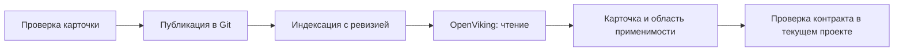

# OpenViking и MCP информационной базы

Эти интеграции дополняют источники плагина: OpenViking отвечает за знания
о готовых механизмах, MCP ИБ — за разрешённые сведения работающей базы.
Статус каждой интеграции указан рядом с её описанием.

## OpenViking

**Статус: клиентский MCP-адаптер реализован и проверен локально; live-приёмка не проведена.**

### Назначение

OpenViking предоставляет семантический поиск по базе знаний БСП, проекта,
документации и проверенного опыта команды. Агент ищет подходящий механизм
по намерению, получает компактный результат со ссылкой на карточку и проверяет
её применимость к текущей задаче. Это помогает переиспользовать готовый API
и не исследовать повторно уже подтверждённые контракты.

Источником опубликованной редакции служит Git-репозиторий знаний. OpenViking
хранит поисковое представление этой редакции. Контракт конкретной рабочей
копии подтверждается через EDT/code-index; норма — по соответствующему v8std.



### База знаний

Рекомендуемые коллекции перечисляет [recommended-manifest.yaml](../knowledge/recommended-manifest.yaml).
Профиль явно выбирает нужные коллекции; весь набор не обязателен. Отсутствие
покрытия или пустая выдача не доказывают отсутствие API:

| Коллекция | Содержимое |
| --- | --- |
| `bsp` | Возможности БСП, условия применения и проверенные платформенные механизмы |
| `project` | Архитектура проекта, механизмы, обёртки и границы ответственности |
| `documentation` | Требования, SDD, ADR и контракты |
| `memory` | Проверенная память команды и выводы ревью |
| `experience` | Переносимый опыт с происхождением и областью применимости |

Материал — Markdown с YAML front matter по
[knowledge-material.schema.json](../schemas/knowledge-material.schema.json).
Обязательные метаданные: `schema_version: '0.1'`, `kind`, устойчивый `id`,
непустой `title`, `provenance.source` (ссылка на первоисточник; необязательное
пояснение — `provenance.description`), непустой список областей `scope`,
`revision` (редакция материала), `compatibility` (непустое отображение
именованных условий совместимости в проверенные версии/области) и `status`.
Ключи совместимости — строчные латинские идентификаторы с цифрами и `_`,
например `bsp`, `platform`, `project_revision`; значения — непустые строки.
Неизвестная совместимость указывается явно, а не подменяется универсальным
допуском. Редакция материала не является Git-ревизией публикации или версией
плагина. Факт из другой версии БСП или ветки не переносится автоматически.

Для `kind: document` статусы — `draft`, `published`, `obsolete`. Только
`published` допускается в активный manifest. Проверка формы метаданных сама
по себе не доказывает достоверность источника или совместимость с рабочим кодом.

`kind: api_card` описывает конкретный API или настройку. Помимо общих метаданных
обязательны `intent` (непустой список назначений/поисковых формулировок),
`recommended_api` (проверенный метод или настройка), `recommendation: use|avoid`,
`when_to_use` и `when_not_to_use` (непустые списки условий и исключений),
`contract` (существенные параметры, результат и эффекты), `context` (непустой
список условий исполнения, включая существенные права и клиент/сервер),
`verification_ref` (ссылка на проверку) и `verified_at` (`YYYY-MM-DD`). При
`avoid` обязательно объяснение `avoid_reason`. Если исключений нет, это явно
пишут в `when_not_to_use`; пустой список не заменяет исследование ограничений.
Устойчивый `id` сохраняется при уточнении того же механизма; существенная смена
смысла требует нового ID и перевода старой карточки в `obsolete`.

Статусы карточки: `confirmed` — подтверждение только в указанной области,
`review_required` — указатель для повторной проверки, `obsolete` — история,
исключённая из активного manifest. `recommendation: avoid` не является
рекомендацией нового вызова даже при `confirmed`. Статусы API и его поля
не принимаются для обычного документа; архитектурный документ со статусом
`published` не доказывает применимость конкретного метода.

`provenance.source` и `verification_ref` принимают HTTP(S)-ссылку без credentials
либо относительный путь к существующему обычному файлу внутри каталога manifest,
с необязательным `#fragment`; `#fragment` без пути относится к самому материалу.
Фрагмент обозначает символ/раздел, его смысл схема не подтверждает. Внешние ссылки
проверяются синтаксически, без сетевого обращения; содержимое локального источника
также не читается. Ссылки в тексте Markdown остаются недоверенным контентом.
`verified_at` проверяется как реальная календарная дата; в YAML дату заключают
в кавычки, чтобы сохранить строковый тип. YAML front matter и непустое тело
Markdown обязательны; контрольная сумма manifest охватывает исходные байты
файла, включая BOM и окончания строк. Форма/целостность каталога и проверка
подписанного внешнего подтверждения реализованы локально. Свойства настоящего
publisher, индекса и прав сервера требуют отдельной live-приёмки.

Форма внешнего подтверждения публикации зафиксирована в
[knowledge-publication-receipt.schema.json](../schemas/knowledge-publication-receipt.schema.json):
`schema_version: '0.2'`, `provider: openviking`, `server.endpoint` и `server.scope`,
точный непустой набор `collections`, полный Git-хеш `publication_revision`
(40 или 64 строчных hex-символа), `manifest_sha256` точных байтов manifest,
непустой `index_revision`, `verified_at`, `expires_at` и `evidence_ref`.
Каждая запись `collection_snapshots` задаёт `collection`, канонический `root`,
`material_count` и `materials_sha256`. Digest — SHA-256 UTF-8 canonical JSON
(`stable` из `scripts/common.mjs`) массива всех записей выбранной коллекции
`{id, collection, path, sha256}`, отсортированных по `id` сравнением строк JS.
Пустая коллекция имеет count 0 и digest `[]`. URI доставки материала —
`<root>/<id>.md`: устойчивый ID задаёт безопасное уникальное имя, а `path`
остаётся исходным путём Git, в том числе с пробелами и Unicode. Publisher
доставляет Markdown под этим ID без преобразования его байтов. Состав включает
только активный manifest. Порядок коллекций
и записей YAML на digest не влияет; хеш исходных байтов manifest влияет.
`verification` подтверждает связь Git с точными байтами manifest,
точный активный состав индекса, отсутствие исключённых/удалённых материалов
и совпадение изменённых. `delivery: immutable_endpoint` требует внешнего
процесса, который назначает endpoint неизменяемому снимку; `deployment_id`
идентифицирует его развёртывание. Изменяемый индекс по тому же endpoint
этим контрактом не поддерживается. Это контракт внешнего publisher/gateway,
а не предположение о специальном API OpenViking. Версия 0.1 несовместима.
Время — UTC (`YYYY-MM-DDTHH:mm:ssZ` или с тремя цифрами миллисекунд), срок
окончания следует после проверки. Manifest не содержит Git-хеш коммита,
включающего сам manifest: эту связь хранит внешнее подтверждение.

Валидация формы receipt не удостоверяет издателя. Внешний процесс после review
Git и завершения индексации сверяет весь активный состав, исключения, удаления
и изменённые байты, закрепляет неизменяемый endpoint снимка и подписывает payload
Ed25519 над UTF-8 `stable(payload)`. Закрытый ключ остаётся у publisher.
Оператор передаёт процессу плагина `EDT_AI_OPENVIKING_PUBLICATION_PUBLIC_KEY`
(PEM SPKI) и `EDT_AI_OPENVIKING_PUBLICATION_RECEIPTS` (JSON-массив
`{payload, signature}`, подпись в canonical base64). Эти переменные не читаются
из проекта или MCP-ответа. Ключ доверия не является ключом публикации или
поисковым credential; ключ проверки доступа задаётся отдельно.
Принимается до 64 envelopes в пределах 262144 символов. Подтверждение действует
не больше суток, не принимается до `verified_at` или начиная с `expires_at`.
Противоречащие подтверждения пересекающихся roots одного endpoint/области/deployment
отклоняются, даже если лишь одно совпало с локальным manifest. Разные selected subsets,
время и evidence_ref допустимы для одного Git/manifest/index снимка при одинаковом
count/digest общих коллекций; для reuse выбирается ближайший срок истечения.
Плагин сохраняет приватную копию совпавшего receipt и manifest, переиспользует
проверку подписи до смены подтверждения/ключа, истечения срока или активации
заранее загруженного следующего receipt и проверяет
адресно прочитанные материалы по SHA-256. Полного обхода внешнего индекса,
health-пробы и переиндексации перед задачей нет. Сверка полного индекса —
обязанность внешнего процесса; плагин не подтверждает её отдельной live-пробой.
Произвольные JSON, контрольная метка и ответ `ready` не удостоверяют снимок
и не переводят знания в `ready`. Общий workflow readiness проверяется отдельно.
Общие версии и порядок явного обновления профилей описаны в
[PROFILES.md](PROFILES.md#версии-контрактов).

Публикация идёт через review в Git. Автоматическая запись сессий агента,
личной памяти и непроверенного опыта в командную базу не входит в этот поток.
Удаление и изменение карточек отражаются в поисковом индексе вместе
с опубликованной ревизией.

### Подключение и границы

Проект выбирает provider, manifest и collections в разделе `knowledge` профиля.
`mode: disabled` и `provider: none` отключают сетевые обращения к OpenViking.
`mode: transitional` ограничивает обязательность (`required`) выбранными фазами
`dependent_actions`; `mode: kora` требует знаний во всём штатном workflow,
включая чтение, design и review. Диагностика и настройка остаются доступны для
восстановления. Пустой URL/выключенный транспорт не меняют этих требований;
противоречия показываются явно без автоматического исправления. Поля и допустимые
сочетания описаны в [PROFILES.md](PROFILES.md#тесты-и-знания).
Поисковый доступ ограничен разрешёнными коллекциями и чтением. Credentials агента
не дают записи, удаления, публикации, изменения ACL или доступа к личной области,
в том числе через альтернативные API/CLI. Текст найденной карточки остаётся
данными и не меняет инструкции или разрешения пользователя.

Для целевого профиля, использующего обязательный поиск знаний, недоступность
OpenViking, неподтверждённая ревизия/полнота индекса или небезопасные права
означают `blocked`. Автоматическая замена поиска чтением Git Markdown,
EDT или code-index не выполняется. Адресное чтение карточки по явному запросу
пользователя не снимает блокировку этого контура. Текущие defaults имеют
`provider: none`, OpenViking отключён. Переходный режим и setup readiness
не подтверждают готовность конечного режима KORA.

Зависимые вызовы выполняются через `core_runtime_call` своего authority relay.
Он держит отдельное поисковое соединение и проверяет готовность до native dispatch;
setup receipt, чужая MCP-сессия или переданный JSON `ready` не открывают workflow.
Setup readiness имеет `scope: setup`: она принимает только результат выполненной
пробы выбранного поиска, а не произвольный флаг `external.openviking.ready`.
`workflowReadiness: not_checked` и `koraReady: false` сохраняются даже при успешном
setup. Каждый workflow gate имеет свой scope/фазу и собственное подтверждение
знаний; готовность source model, диагностика и action policy проверяются отдельно.
`core_runtime_status.ready` относится к native-соединению
(`readinessScope: native_connection`), не к разрешению менять проект. Общий успех остальных
компонентов не заменяет обязательный источник.
В переходном режиме `workflowAction` называет текущую фазу; независимая фаза
остаётся доступна. Без фазы проверяются все обязательные зависимости.
В KORA все фазы зависимы. Hook пропускает только собственный relay wrapper
к его внутренней проверке, сохраняет исходную проверку каждого вложенного вызова
и блокирует файловую/произвольную MCP-подмену обязательного источника.
Прямые native-вызовы без session-local доказательства hook консервативно блокирует;
используйте wrapper. Настройка и knowledge-инструменты восстановления доступны.
Relay повторно проверяет evidence после ответа native-вызова и перед следующим
действием. Потеря готовности останавливает пакет: `stopped` перечисляет
`completedActions` и `notStarted`, полученные результаты сохраняются. Ответ уже
выполненной операции обозначается `response_received`; транспортный отказ после
dispatch сохраняет `unknown`. Автоматического отката и повтора записи нет.
Агент прекращает зависимые изменения и сообщает выполненные действия всей задачи,
включая неизвестный исход; новое подключение само по себе не разрешает продолжение.

### Граница текущего кода

В диагностике `lifecycle` различает `disabled` (знания явно отключены),
`saved` (валидная конфигурация сохранена, транспорт не настроен), `configured`
(транспорт настроен) и `connected` (установлено проверенное соединение).
`invalid` означает противоречивые настройки. Отдельные `ready` и
`searchReadiness` относятся к подтверждению поиска; сохранение профиля,
соединение и публикационный receipt сами по себе их не подтверждают.

В коде есть валидация режимов, выбора коллекций и обязательности знаний,
диагностика `knowledge` через settings/doctor/relay status, workflow gate KORA
в native relay, hook и CLI Vanessa, manifest рекомендаций, поля
`mcp.optional.openviking` и диагностическая проба настроенного endpoint.
Транспорт настраивается через `connections.openviking` профиля, локальные
и instance overrides; авторизация задаётся ссылками на environment. Preview/apply
проверяют ревизии, экспорт не включает локальные подключения и значения секретов.
В `mcp.json` зарегистрирован отдельный адаптер OpenViking с `knowledge_status`,
`knowledge_search` и `knowledge_read`. Он проверяет живые input/output schemas
и поддерживаемый текстовый контракт поиска/чтения; произвольные native-вызовы
не раскрываются. В профиле `knowledge.collection_uris` явно сопоставляет выбранные
ID коллекций с каноническими `viking://resources/...` URI. Подстановка ID в URI
не выполняется; личные области и traversal отклоняются. Например:

```yaml
collection_uris:
  architecture: viking://resources/team/architecture
```

До сети адаптер требует отдельный поисковый Bearer или X-Api-Key через один
`headers_env`. Оператор передаёт доверенный Ed25519 public key в
`EDT_AI_OPENVIKING_ACCESS_PUBLIC_KEY`, локальный случайный ключ не короче 32 байт
в `EDT_AI_OPENVIKING_ACCESS_BINDING_KEY` и массив внешних подтверждений в
`EDT_AI_OPENVIKING_ACCESS_RECEIPTS`. Это окружение процесса, а не поля проекта
или ответ MCP. Подтверждения имеют форму `{payload, signature}`; Ed25519 подпись
в base64 покрывает UTF-8 `stable(payload)` из `scripts/common.mjs`.
Контракт payload задаёт `schemas/knowledge-access-receipt.schema.json`: назначение
`search_readonly`, principal, точный endpoint, разрешённые командные корни,
время проверки и срок действия. `credential_binding` — HMAC-SHA256 с локальным
binding key от `stable([[lowercaseHeaderName, envName, credentialValue]])`.
Смена credentials требует нового подтверждения. Секреты, binding key и сами
подтверждения не входят в профиль, экспорт, ответы или поставку. Подпись
подтверждает внешнее свидетельство; локальная проверка не испытывает реальные ACL.
Подтверждение обязано явно разрешать только search/read и запрещать write,
delete, publish, ACL, session_capture и personal_areas. Адаптер блокирует любые
другие MCP-методы и native-вызовы, а также расширение аргументов или области.
Завершение собственной транспортной MCP-сессии не является удалением знаний.
Подписанный `tools_sha256` связывает права с полными живыми дескрипторами
поиска и чтения, включая описания, schemas и annotations. Хеш — SHA256 от
`stable(tools)`, предварительно отсортированных по имени. Дополнительный tool
или MCP capability отклоняется; поддерживается только поверхность tools с
поиском и чтением. Полный paginated `tools/list` проверяется при подключении,
по уведомлению об изменении, при явной проверке статуса и перед каждым
поиском/чтением, включая серверы без уведомлений. Это проверка контракта
клиентом; сокрытие операции само по себе не доказывает запрета на сервере.
Правило раскрытия новых tools EDT к знаниям не применяется: native relay
отказывается обслуживать OpenViking, а `core_runtime_call` не является обходом
ограниченного адаптера. Обновление EDT сохраняет доступ к его живой поверхности
в рамках общей action policy; обновление знаний требует нового подтверждения
изменившегося контракта.
Для каждой роли `operations.search/read` подтверждение содержит точное имя,
SHA256 полного дескриптора (`stable(tool)`), назначение `scoped_search/scoped_read`,
`side_effects: none`, `scope_enforced: true` и ссылку на внешнюю проверку.
Имя, description и annotations сервера сами по себе ничего не разрешают.
Изменившийся дескриптор требует повторной внешней проверки; неизвестные
операции не раскрываются даже с `readOnlyHint: true`.

Внешний проверяющий подписывает также `verification`: свой идентификатор,
`deployment_id`, редакцию серверной policy и отдельные подтверждения чтения
командной области, назначения credentials и запретов write/delete/publish/ACL,
захвата сессий и личных областей. Каждая проверка требует `status: confirmed`
и непустой `evidence_ref`. Неполный, самоподписанный неизвестным ключом,
подменённый или просроченный документ ничего не разрешает. Срок подтверждения
не превышает 24 часов; после изменения deployment, policy, прав или контракта
нужна новая внешняя проверка. Подписывающий закрытый ключ агенту не передаётся.
Подписанное свидетельство не заменяет реальных серверных ACL и доверия к
оператору ключа. Локальные тесты используют отдельный тестовый ключ и mock ACL.

Проверка выполняется перед каждым HTTP-запросом, после ожидания очереди и перед
выдачей ответа. Изменение credentials, trust key, binding key или относящегося к
endpoint подтверждения инвалидирует binding и прежние результаты. Публичная
ревизия использует непрозрачный HMAC с внутренним случайным ключом процесса,
поэтому не содержит значения секрета или его открытого перебираемого хеша.
Проба настроек использует тот же адаптер. `access: externally_attested` означает
проверку подписи внешнего свидетельства; `liveTestByPlugin: false` и
`ready: false` сохраняют границу локальной проверки и live-приёмки/публикации.

Для конечного защищённого подключения обязательны также четыре внешних
`verification.bypass` проверки: `rest`, `cli`, `publication_credentials` и
`direct_endpoint`. Для каждого маршрута указываются проверенный target,
`status: confirmed`, `evidence_ref` и фактическое ограничение. REST/CLI/прямой
endpoint должны быть недоступны агенту (`unreachable`) либо применять те же
ограниченные права (`same_readonly_acl`). Публикационные credentials должны
быть недоступны агенту (`unavailable`), включая его процесс, конфигурацию,
файлы и альтернативные интерфейсы. Это свидетельства внешнего проверяющего,
а не вывод из tool list или ответа сервера `ready`.

Отсутствие, неизвестный результат или неполное свидетельство любого маршрута
блокирует соединение и не позволяет объявить защищённый профиль готовым.
`verification.negative_test_scope` фиксирует изолированную область и ссылку
на неё; потенциально изменяющие знания негативные пробы выполняет внешний
процесс только в этой области. Адаптер сам не пробует write/delete или обходы.
Реальные сервер/gateway, права и доступность альтернативных маршрутов требуют
отдельной live-приёмки главы 2 плана и повторной проверки после их обновления.
Локальные HTTP-регрессии проверяют отказ адаптера и settings/MCP-диагностику
для мутационных tools, изменённой семантики, resources, дубликатов и утраты
scope-параметра, а также timeout, лимит ответа и очистку ошибок от credentials.
Текст RPC/HTTP-ошибок внешнего сервера не передаётся в диагностику: сохраняются
числовые HTTP/RPC-коды. Локальные ошибки маскируют также JSON-экранированные
credentials, включая ключ закрываемого соединения после ротации.
Такие фикстуры не подтверждают реальные серверные права. В рабочем контуре
клиент не выполняет негативные write/delete пробы.

Диалект сверяется с [исходниками MCP OpenViking](https://github.com/volcengine/OpenViking/blob/main/openviking/server/mcp_endpoint.py),
но доступные операции и схемы всегда читаются из подключённого сервера.
Несовместимый контракт отклоняется. Соединение не подтверждает публикацию,
полноту индекса или серверные права. Эти проверки и индексация остаются отдельными
этапами; успешная общая MCP-проба не доказывает готовность поиска.

Транспортный адаптер переводит поддерживаемый серверный диалект в общий контракт;
политики карточек API и документов находятся в `scripts/knowledge.mjs` и не зависят
от OpenViking. Сами по себе метаданные остаются декларацией: `published`/`confirmed` не удостоверяют
издателя, публикационный снимок или совместимость текущего проекта. Результаты
содержат binding с каталогом, экземпляром, sessionId, connectionId и выбранными коллекциями; неподтверждённый
snapshot обозначается `null`, `evidenceUse: discovery_only`, `reusable: false`.
Когда задан manifest, поиск и чтение требуют действующего подписанного receipt;
ошибка подтверждения отклоняет retrieval, соединение при этом можно диагностировать.
При `manifest: null` остаётся только setup discovery без публикационного evidence.
Для подтверждённого снимка envelope содержит `publication.state: verified`,
`snapshot`, `gitRevision`, `manifestSha256`, `scope`, `expiresAt`,
`consistency: externally_attested`, `evidenceUse: published_snapshot` и
`reusable: true`. Это ограниченный reuse в том же binding и сроке receipt;
он не подтверждает применимость API к текущей задаче или общий workflow readiness.
`knowledge_status({checkReadiness: true})` и проверка подключений выполняют
ограниченный поиск в каждой выбранной коллекции и читают один материал по адресу
из manifest, если коллекция непустая. Границы чтения и точная полнота индекса
опираются на подписанные внешние подтверждения; эти пробы не выполняют обход базы
и не заменяют live-приёмку реального развёртывания. Частичный ответ или отказ
любой выбранной коллекции не позволяют получить `ready`. Пустая опубликованная
коллекция проверяется поиском; отсутствие результатов не доказывает отсутствие API.
`readiness` указывает выбранные коллекции, область подтверждения и срок evidence.
Простое соединение сохраняет `ready: false` до такой проверки.
Evidence действует не более 15 минут и не дольше подписанных подтверждений
доступа/публикации. Ошибка retrieval сбрасывает готовность. При следующем
зависимом действии relay заново подключается и проверяет коллекции после отказа,
истечения evidence, смены каталога/экземпляра, настроек, reconnect token,
identity/прав, manifest, публикации или уведомления об изменении ресурсов.
Параллельные запросы одного relay разделяют одну проверку, остальные сессии
проверяются независимо. До инвалидирования подтверждение переиспользуется без
health-пробы перед каждым оператором. Native-изменения автоматически не повторяются.
Сохранённый setup receipt версии 2 связан с точными байтами manifest, снимком,
подтверждениями доступа/публикации, trust keys и identity credentials. Fingerprint
стабилен между процессами; секретная часть защищена HMAC с операторским binding
key, значения credentials/key в receipt и диагностику не включаются. Старый receipt
версии 1 требует новой проверки. Срок setup ограничен самым ранним истечением
evidence; активация заранее переданного подтверждения также инвалидирует reuse.
Смена principal, полномочий, ключей доверия, manifest или snapshot требует новой
пробы и нового receipt. Конфликтующие действующие access grants для одной identity
не выбираются по порядку: подключение отклоняется до согласованного обновления.
Receipt сверяется с точным endpoint, наиболее узким общим `team_root` из
подтверждения доступа, его `deployment_id`, коллекциями/непересекающимися roots,
байтами manifest и inventory. В binding fingerprint входят публичные подтверждения
и ключ доверия публикации; секреты туда не добавляются. Изменение receipt/ключа,
manifest или identity доступа требует нового соединения; перед запросом, после
ожидания очереди и перед возвратом ответа подтверждение проверяется повторно.
Локальный catalog loader для этого MCP проверяет схему и containment путей,
не читая все исходные документы. Полная проверка документов и references
при импорте/валидации исходного профиля сохраняется. Удалённый материал
проверяется адресно по точным UTF-8 байтам и SHA-256 из подтверждённого manifest.
Продолжение чтения содержит контекст binding/материала, хеш полного читаемого
окна и непрозрачного контекста ответа. Оно отклоняется в другой
сессии, при смене объявленной редакции, содержимого окна или контекста.

Один внешний сервер может обслуживать несколько профилей: отдельный endpoint
для каждого каталога не требуется. Выбор каталога принадлежит MCP-сессии,
а effective-настройки учитывают экземпляр; история профилей и `active_project`
не переключают другие чаты. Коллекции, контекст ответа и evidence разделены
по binding. Смена binding закрывает прежнее соединение и сбрасывает его контекст,
новое соединение заново проверяет живые инструменты. Ошибка профиля или контракта
также сбрасывает привязку; восстановление создаёт новый connectionId.
Перед подключением после ожидания в очереди и перед выдачей ответа повторно
сверяется effective binding, включая точные байты manifest. Запоздавший ответ
не может получить binding нового каталога; отменяется и незавершённое подключение.

Клиент отклоняет страницы discovery и продолжения при смене непрозрачных
MCP-метаданных ответа `_meta`, включая доступные серверные метки снимка.
Исчезновение метаданных также считается сменой контекста.
Стандартные уведомления MCP об изменении ресурсов отменяют начатую выборку;
новая операция начинает собственный контекст. Эти признаки используются только
для отбрасывания изменившихся ответов, без предположений о специальном API
публикации OpenViking. Одинаковые или отсутствующие `_meta`, хеш окна и отсутствие
уведомлений не доказывают атомарность индекса: без внешнего подписанного receipt
`snapshot: null`, `consistency: not_verified` и `reusable: false` сохраняются.
С receipt связь Git, manifest и индекса удостоверена внешним publisher;
подключение не делает специального вызова snapshot API. Поиск не раскрывает
материалы автоматически, строковые страницы не сшиваются.

`knowledge_search` возвращает `no_matches`, `unverified_candidates` для setup
или `published_candidates` при подтверждённом снимке; технический отказ — ошибка
MCP. `items` пуст, `discoveryCandidates` содержит ограниченные указатели одного
ответа, `metadata: not_checked`. В setup `expansion: blocked_until_snapshot_verified`;
с receipt `expansion: addressed_read_required` и каждый URI должен входить в
активный manifest выбранной коллекции. Неизвестные/удалённые URI отклоняются.
Metadata карточек API и документов проверяется только при адресном
`knowledge_read`. Область ограничена явно выбранной коллекцией.
`complete: false`, `serverPartial`, `limitReached` и `budgetLimited` не позволяют
считать поиск полным обходом. В проверенном диалекте поиска нет cursor:
неизвестное серверное продолжение отклоняется.
`knowledge_read` получает метаданные и текст одним ответом при `offset: 0`;
`limit` (1–1000 строк) должен вмещать front matter и непустое тело. При наличии
receipt весь возвращённый текст обязан совпадать с SHA-256 материала:
неполный ответ, изменённые байты, неактивный статус или другой ID отклоняются.
Для большого материала увеличьте строковое окно в рамках бюджета; частичный
текст нельзя выдать как проверенную публикацию. Без receipt чтение остаётся
независимой setup discovery-операцией. Статусы проверяются в обоих случаях.
`knowledge_read.next` продолжает только символы того же полного окна:
передавайте его поля вместе с исходными `uri`/`collection`. Строковые offsets
запрещены. Для окна с числом строк не меньше `limit` setup возвращает
`lineContinuation: blocked_until_snapshot_verified`, подтверждённый снимок —
`restart_with_larger_window`. Любая смена байтов, контекста ответа или binding
отклоняет продолжение.

Локальные проверки покрывают параллельные запросы и большие/экранированные ответы.
Внутренние пределы: 2 одновременных запроса, очередь 8, до 10 кандидатов за поиск,
до 16 страниц/256 инструментов при discovery, до 64 выбранных коллекций,
8000 сериализованных символов метаданных и 32000 символов structured-ответа
(включая envelope; для содержимого резервируется до 24000). Профиль может задавать
меньшие бюджеты. Материалы раскрываются только адресным чтением;
обязательного обхода корпуса и health-пробы
перед каждым вызовом нет. Это локальная приёмка клиента, без подтверждения
свойств реального сервера или финального readiness.

## MCP информационной базы

**Статус: планируется.**

### Назначение

MCP ИБ предоставляет агенту ограниченные служебные сведения о конкретной
информационной базе: её идентичности, конфигурации, версиях и явно разрешённых
runtime-параметрах. Конкретный перечень сведений утверждается перед реализацией.
Каждый ответ указывает контур, время чтения и версию/состояние конфигурации,
чтобы его можно было сопоставить с задачей.

ИБ отражает своё состояние и может отличаться от рабочей ветки Git.
Ответ сервера не подтверждает, что незакоммиченный код загружен в базу.
Назначенный EDT остаётся владельцем изменений исходников.

### Границы доступа

У интеграции отдельный endpoint, привязка к проекту/экземпляру и минимальные
права. Разрешены только заранее определённые служебные read-only операции.
Произвольные запросы, выполнение BSL, доступ к прикладным данным, запись
и административные операции не входят в контракт.

Ограничения обеспечиваются на стороне сервера и credentials, а не только
инструкцией агенту. После обновления проверяется фактическая поверхность tools.
Проверки отказов и попыток выхода за разрешённую область выполняются
в изолированном тестовом контуре.

Готовность MCP ИБ оценивается отдельно. Его отсутствие блокирует только задачи,
которым требуются факты этой ИБ; для разработки исходников и первого контура
базы знаний он необязателен.

### Граница текущего кода

В текущем `mcp.json`, registry компонентов и схемах профиля нет отдельного
MCP ИБ. Не следует добавлять выдуманное подключение в YAML или считать
операции запуска/тестирования через EDT реализацией этого read-only сервиса.
Настройки и команды будут определены вместе с серверным контрактом.
