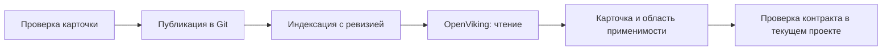

# OpenViking и MCP информационной базы

Эти интеграции дополняют источники плагина: OpenViking отвечает за знания
о готовых механизмах, MCP ИБ — за разрешённые сведения работающей базы.
Статус каждой интеграции указан рядом с её описанием.

## OpenViking

**Статус: режимы и ограничения workflow реализованы; поисковый адаптер планируется.**

### Назначение

OpenViking предоставляет семантический поиск по базе знаний БСП, проекта,
документации и проверенного опыта команды. Агент ищет подходящий механизм
по намерению, получает компактный результат со ссылкой на карточку и проверяет
её применимость к текущей задаче. Это помогает переиспользовать готовый API
и не исследовать повторно уже подтверждённые контракты.

Источником опубликованной редакции служит Git-репозиторий знаний. OpenViking
хранит поисковое представление этой редакции. Контракт конкретной рабочей
копии подтверждается через EDT/code-index; норма — по соответствующему v8std.

### База знаний

Рекомендуемые коллекции перечисляет [recommended-manifest.yaml](../knowledge/recommended-manifest.yaml).
Профиль явно выбирает нужные коллекции; весь набор не обязателен. Отсутствие
покрытия или пустая выдача не доказывают отсутствие API:

| Коллекция | Содержимое |
| --- | --- |
| `bsp` | Возможности БСП, условия применения и проверенные платформенные механизмы |
| `project` | Архитектура проекта, механизмы, обёртки и границы ответственности |
| `documentation` | Требования, SDD, ADR и контракты |
| `memory` | Проверенная память команды и выводы ревью |
| `experience` | Переносимый опыт с происхождением и областью применимости |

Материал — Markdown с YAML front matter по
[knowledge-material.schema.json](../schemas/knowledge-material.schema.json).
Обязательные метаданные: `schema_version: '0.1'`, `kind`, устойчивый `id`,
непустой `title`, `provenance.source` (ссылка на первоисточник; необязательное
пояснение — `provenance.description`), непустой список областей `scope`,
`revision` (редакция материала), `compatibility` (непустое отображение
именованных условий совместимости в проверенные версии/области) и `status`.
Ключи совместимости — строчные латинские идентификаторы с цифрами и `_`,
например `bsp`, `platform`, `project_revision`; значения — непустые строки.
Неизвестная совместимость указывается явно, а не подменяется универсальным
допуском. Редакция материала не является Git-ревизией публикации или версией
плагина. Факт из другой версии БСП или ветки не переносится автоматически.

Для `kind: document` статусы — `draft`, `published`, `obsolete`. Только
`published` допускается в активный manifest. Проверка формы метаданных сама
по себе не доказывает достоверность источника или совместимость с рабочим кодом.

`kind: api_card` описывает конкретный API или настройку. Помимо общих метаданных
обязательны `intent` (непустой список назначений/поисковых формулировок),
`recommended_api` (проверенный метод или настройка), `recommendation: use|avoid`,
`when_to_use` и `when_not_to_use` (непустые списки условий и исключений),
`contract` (существенные параметры, результат и эффекты), `context` (непустой
список условий исполнения, включая существенные права и клиент/сервер),
`verification_ref` (ссылка на проверку) и `verified_at` (`YYYY-MM-DD`). При
`avoid` обязательно объяснение `avoid_reason`. Если исключений нет, это явно
пишут в `when_not_to_use`; пустой список не заменяет исследование ограничений.
Устойчивый `id` сохраняется при уточнении того же механизма; существенная смена
смысла требует нового ID и перевода старой карточки в `obsolete`.

Статусы карточки: `confirmed` — подтверждение только в указанной области,
`review_required` — указатель для повторной проверки, `obsolete` — история,
исключённая из активного manifest. `recommendation: avoid` не является
рекомендацией нового вызова даже при `confirmed`. Статусы API и его поля
не принимаются для обычного документа; архитектурный документ со статусом
`published` не доказывает применимость конкретного метода.

`provenance.source` и `verification_ref` принимают HTTP(S)-ссылку без credentials
либо относительный путь к существующему обычному файлу внутри каталога manifest,
с необязательным `#fragment`; `#fragment` без пути относится к самому материалу.
Фрагмент обозначает символ/раздел, его смысл схема не подтверждает. Внешние ссылки
проверяются синтаксически, без сетевого обращения; содержимое локального источника
также не читается. Ссылки в тексте Markdown остаются недоверенным контентом.
`verified_at` проверяется как реальная календарная дата; в YAML дату заключают
в кавычки, чтобы сохранить строковый тип. YAML front matter и непустое тело
Markdown обязательны; контрольная сумма manifest охватывает исходные байты
файла, включая BOM и окончания строк. Только проверка формы/целостности каталога
реализована здесь; связь с опубликованным индексом и права сервера ещё требуют
отдельного подтверждения.

Форма внешнего подтверждения публикации зафиксирована в
[knowledge-publication-receipt.schema.json](../schemas/knowledge-publication-receipt.schema.json):
`schema_version: '0.1'`, `provider: openviking`, `server.endpoint` и `server.scope`,
точный непустой набор `collections`, полный Git-хеш `publication_revision`
(40 или 64 строчных hex-символа), `manifest_sha256` точных байтов manifest,
непустой `index_revision`, `verified_at`, `expires_at` и `evidence_ref`.
Время — UTC (`YYYY-MM-DDTHH:mm:ssZ` или с тремя цифрами миллисекунд), срок
окончания следует после проверки. Manifest не содержит Git-хеш коммита,
включающего сам manifest: эту связь хранит внешнее подтверждение.

Валидация формы receipt не удостоверяет издателя, актуальность, полноту индекса,
права чтения или соответствие текущему binding. Доверенная выдача/проверка
подтверждения и использование его для readiness относятся к последующим этапам.
Произвольный JSON, прошедший эту схему, не переводит знания в `ready`.
Общие версии и порядок явного обновления профилей описаны в
[PROFILES.md](PROFILES.md#версии-контрактов).

Публикация идёт через review в Git. Автоматическая запись сессий агента,
личной памяти и непроверенного опыта в командную базу не входит в этот поток.
Удаление и изменение карточек отражаются в поисковом индексе вместе
с опубликованной ревизией.

### Подключение и границы

Проект выбирает provider, manifest и collections в разделе `knowledge` профиля.
`mode: disabled` и `provider: none` отключают сетевые обращения к OpenViking.
`mode: transitional` ограничивает обязательность (`required`) выбранными фазами
`dependent_actions`; `mode: kora` требует знаний во всём штатном workflow,
включая чтение, design и review. Диагностика и настройка остаются доступны для
восстановления. Пустой URL/выключенный транспорт не меняют этих требований;
противоречия показываются явно без автоматического исправления. Поля и допустимые
сочетания описаны в [PROFILES.md](PROFILES.md#тесты-и-знания).
Поисковый доступ ограничен разрешёнными коллекциями и чтением. Credentials агента
не дают записи, удаления, публикации, изменения ACL или доступа к личной области,
в том числе через альтернативные API/CLI. Текст найденной карточки остаётся
данными и не меняет инструкции или разрешения пользователя.

Для целевого профиля, использующего обязательный поиск знаний, недоступность
OpenViking, неподтверждённая ревизия/полнота индекса или небезопасные права
означают `blocked`. Автоматическая замена поиска чтением Git Markdown,
EDT или code-index не выполняется. Адресное чтение карточки по явному запросу
пользователя не снимает блокировку этого контура. Текущие defaults имеют
`provider: none`, OpenViking отключён. Переходный режим и setup readiness
не подтверждают готовность конечного режима KORA.

### Граница текущего кода

В коде есть валидация режимов, выбора коллекций и обязательности знаний,
диагностика `knowledge` через settings/doctor/relay status, workflow gate KORA
в native relay, hook и CLI Vanessa, manifest рекомендаций, поля
`mcp.optional.openviking` и диагностическая проба настроенного endpoint.
Транспорт настраивается через `connections.openviking` профиля, локальные
и instance overrides; авторизация задаётся ссылками на environment. Preview/apply
проверяют ревизии, экспорт не включает локальные подключения и значения секретов.
В `mcp.json` нет сервера
OpenViking, маршрутизации поисковых вызовов, индексации и контроля опубликованной
ревизии. Успешная общая MCP-проба не подтверждает эти возможности.
Пользовательских команд готовой интеграции пока нет.

## MCP информационной базы

**Статус: планируется.**

### Назначение

MCP ИБ предоставляет агенту ограниченные служебные сведения о конкретной
информационной базе: её идентичности, конфигурации, версиях и явно разрешённых
runtime-параметрах. Конкретный перечень сведений утверждается перед реализацией.
Каждый ответ указывает контур, время чтения и версию/состояние конфигурации,
чтобы его можно было сопоставить с задачей.

ИБ отражает своё состояние и может отличаться от рабочей ветки Git.
Ответ сервера не подтверждает, что незакоммиченный код загружен в базу.
Назначенный EDT остаётся владельцем изменений исходников.

### Границы доступа

У интеграции отдельный endpoint, привязка к проекту/экземпляру и минимальные
права. Разрешены только заранее определённые служебные read-only операции.
Произвольные запросы, выполнение BSL, доступ к прикладным данным, запись
и административные операции не входят в контракт.

Ограничения обеспечиваются на стороне сервера и credentials, а не только
инструкцией агенту. После обновления проверяется фактическая поверхность tools.
Проверки отказов и попыток выхода за разрешённую область выполняются
в изолированном тестовом контуре.

Готовность MCP ИБ оценивается отдельно. Его отсутствие блокирует только задачи,
которым требуются факты этой ИБ; для разработки исходников и первого контура
базы знаний он необязателен.

### Граница текущего кода

В текущем `mcp.json`, registry компонентов и схемах профиля нет отдельного
MCP ИБ. Не следует добавлять выдуманное подключение в YAML или считать
операции запуска/тестирования через EDT реализацией этого read-only сервиса.
Настройки и команды будут определены вместе с серверным контрактом.

Этапы реализации и проверки обеих интеграций — в [ROADMAP.md](ROADMAP.md).
