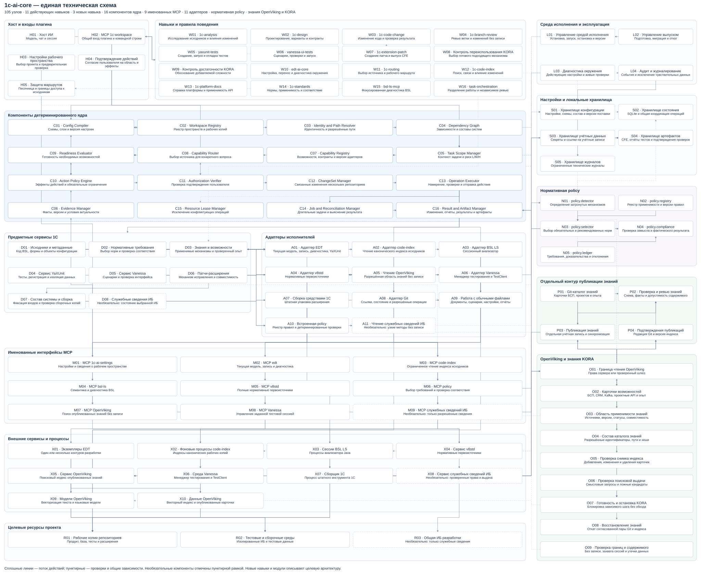

# Техническая архитектура ядра плагина 1С

**Статус:** целевой технический контракт для реализации.  
**Редакция:** 1, 19 октября 2026 года.

Архитектура конкретизирует [общую модель плагина](ARCHITECTURE.md): одно модульное ядро, явный workspace, независимые repositories, проверяемые операции и отдельный контур публикации знаний. Ниже находится **одна полная схема**: все самостоятельные компоненты ядра, workflows, adapters, хранилища и внешние исполнители имеют отдельные ID. Вспомогательные функции и DTO относятся к своим компонентам.

Технический вариант реализации — TypeScript с исполнением собранного JavaScript в Node.js. Ядро работает локально, не вызывает модель самостоятельно и не требует собственного серверного оркестратора. Поддерживаемая версия Node.js и внешних инструментов фиксируется release lock; существующие реализации могут сохраняться за versioned adapters.

## 1 Единая техническая схема

Полнота схемы: **105 узлов**, включая **16 компонентов ядра C01–C16**. Сплошные стрелки показывают основной поток запроса или работу с ресурсом; пунктирные — общую зависимость, проверку или управление жизненным циклом. Стрелка к группе относится к её компонентам; все они раскрыты на этой же схеме. Группы не означают отдельные микросервисы.



[Полный SVG](architecture/technical-plugin.svg) · [PNG](architecture/technical-plugin.png) · [Исходник Mermaid](architecture/technical-plugin.mmd)

## 2 Процессы и границы исполнения

Одна сессия хоста получает один процесс Core Runtime с facade H02. В этом процессе работают C01–C16, D01–D08, встроенная policy N01–N05, проверки знаний O01–O09, модули жизненного цикла и код адаптеров. UI H03 обращается к тому же facade; CLI использует те же сервисы. Навыки W01–W16 поставляются как инструкции агенту и не являются скрытыми фоновыми агентами. На схеме сохранены точные названия всех 11 активных навыков каталога; 1c-analysis, 1c-design и 1c-extension-patch добавляются целевой архитектурой. W08/W09 — два общих контроля KORA.

Code-index X02 — managed daemon, BSL LS X03 — сессионный subprocess. EDT X01, v8std X04 и OpenViking X05 являются подключаемыми сервисами. Vanessa X06 и native builder X07 запускаются или подключаются только в объявленной среде и с разрешёнными effects. Provider конкретной capability выбирается до dispatch и проверяется по установленному контракту.

Контур P01–P04 работает под отдельной identity. Его публикационные credentials и прямой writer-доступ к OpenViking отсутствуют у Core Runtime. Поисковая операция не выполняет Git sync, переиндексацию или capture сессии.

Доступ к сериализованным 1С-исходникам проходит через A01/A02/A03. A08 получает Git metadata и разрешённые Git-операции; source diff относится к назначенной source authority. A09 работает с обычными документами, settings и feature-файлами. Прямые endpoints и generic tools, позволяющие обойти эти границы, не включаются в управляемый контур. Проверка hook и реального host/server enforcement выполняется отдельно.

Именованные MCP M01–M09 показывают логические интеграционные интерфейсы. Они не требуют девяти независимых процессов и не дают хосту обходить общий facade H02. Текущие шесть имён из mcp.json представлены явно; OpenViking, Vanessa и служебные сведения ИБ добавлены целевой моделью. MCP policy может исполняться как встроенный модуль за тем же интерфейсом. Необязательные D08/A11/M09/X08/R03 включаются только после отдельной приёмки.

## 3 Реестр компонентов

### Хост и входы плагина

| ID | Компонент | Контракт |
| --- | --- | --- |
| H01 | Хост ИИ | Хост выполняет reasoning и показывает результат; плагин не содержит собственной модели. |
| H02 | MCP 1c-workspace | Принимает типизированные запросы, session roots и возвращает ограниченные результаты. |
| H03 | Настройки рабочего пространства | Редактирует разрешённые настройки через Config Compiler и показывает происхождение effective values. |
| H04 | Подтверждение действий | Фиксирует согласие в доверенном host/UI-контуре, связывает его с target и effects. |
| H05 | Защита маршрутов | Ограничивает generic tools и обход прямыми writer-подключениями; hook дополняет host/server isolation. |

### Навыки и правила поведения

| ID | Компонент | Контракт |
| --- | --- | --- |
| W01 | 1c-analysis | Выдаёт анализ с источниками и границами покрытия, без неразрешённой записи. |
| W02 | 1c-design | Определяет решение, затронутые компоненты и проверяемые критерии по классу риска. |
| W03 | 1c-code-change | Ведёт согласованный ChangeSet через proposal, запись, диагностику, тесты и diff. |
| W04 | 1c-branch-review | Ревью точных ревизий и изменений; проверка готовности, поведения и доказательств без права исправления. |
| W05 | yaxunit-tests | Разделяет product, тесты и framework, проверяет регистрацию, данные и результаты запуска. |
| W06 | vanessa-ui-tests | Фиксирует feature/scenario/hash, manager/TestClient и наблюдаемый business result. |
| W07 | 1c-extension-patch | Ведёт отдельный extension component от контракта базы до проверенного артефакта. |
| W08 | Контроль переиспользования KORA | Проверяет новую смысловую операцию; переиспользует установленный применимый контракт. |
| W09 | Контроль достаточности KORA | Проверяет основания нетривиальных guards, fallback, обработчиков, обёрток и API. |
| W10 | edt-ai-core | Создание и перенос настроек, подтверждение привязок, диагностика среды исполнения. |
| W11 | 1c-routing | Назначает источник ответа по вопросу, компоненту и актуальному контексту. |
| W12 | 1c-code-index | Ограниченный поиск кода, структуры, потребителей и влияния по точному индексу. |
| W13 | 1c-platform-docs | Подробная справка платформы через назначенный EDT, с проверкой версии и контекста. |
| W14 | 1c-standards | Выбор требований, нормативные первоисточники и проверки до/после изменения. |
| W15 | bsl-ls-mcp | Дополнительная диагностика и семантика в разрешённом корне; не заменяет EDT. |
| W16 | task-orchestration | Независимые задачи и read-only reviewer по необходимости и классу риска. |

### Компоненты детерминированного ядра

| ID | Компонент | Контракт |
| --- | --- | --- |
| C01 | Config Compiler | compile(inputs) → EffectiveConfig с provenance каждого значения и обязательными ограничениями. |
| C02 | Workspace Registry | resolveWorkspace(selection) → WorkspaceRef; ведёт явный реестр и не угадывает соседние профили. |
| C03 | Identity and Path Resolver | resolveTarget(ref) → PhysicalTarget; проверяет разрешённые корни, symlinks, component и live binding. |
| C04 | Dependency Graph | resolveClosure(scope) → ReadClosure/AssemblyPlan; не расширяет Write set по зависимости. |
| C05 | Task Scope Manager | bindTask(intent) → TaskContext; фиксирует mode, критерии, read/write sets и среды. |
| C06 | Evidence Manager | getFacts(query) / invalidate(cause); хранит краткие факты с coverage и условиями актуальности. |
| C07 | Capability Registry | resolveCapability(requirement) → CapabilityRef; допускает только установленный проверенный adapter contract. |
| C08 | Capability Router | route(question, target) → RoutePlan; различает canonical source, live projection, docs, norms и knowledge. |
| C09 | Readiness Evaluator | evaluate(step) → Ready/Blocked с evidence и причинами; unknown не является готовностью. |
| C10 | Action Policy Engine | check(action, scope) → Decision; использует классификацию доверенного адаптера и обязательные правила. |
| C11 | Authorization Verifier | verify(receipt, action) → Authorization; JSON от модели не создаёт полномочия. |
| C12 | ChangeSet Manager | prepareChangeSet(scope) → ChangeSet; хранит зависимости, snapshots и частичное состояние. |
| C13 | Operation Executor | execute(action) → OperationRef/Outcome; до записи сохраняет intent и проверяет свежие guards. |
| C14 | Job and Reconciliation Manager | inspect(operation) / reconcile(operation) → KnownOutcome; не повторяет сомнительную запись. |
| C15 | Resource Lease Manager | acquire(physicalResource) → Lease; координирует сессии разных workspace и экземпляров. |
| C16 | Result and Artifact Manager | record(result) → ResultRef; связывает результат с inputs, assembly, run и artifact hash. |

### Предметные сервисы 1С

| ID | Компонент | Контракт |
| --- | --- | --- |
| D01 | Исходники и метаданные | Формирует ограниченные запросы и изменения с точным владельцем и EDT validation. |
| D02 | Нормативные требования | Объединяет deterministic policy selection с точными текстами v8std и proposal/result evidence. |
| D03 | Знания и возможности | Фильтрует допустимые scopes, provenance, compatibility и подтверждённую публикационную пару. |
| D04 | Сервис YaXUnit | Работает с test/framework/product binding, assertions, fixtures и результатом того же run. |
| D05 | Сервис Vanessa | Проверяет исполняемый текст, владение UI-сессией, assertions и актуальный receipt. |
| D06 | Патчи-расширения | Проверяет базовую поставку, extension ownership, зависимости и поддержанный способ изменения. |
| D07 | Состав системы и сборка | Фиксирует входные snapshots, согласует test projections и собирает кандидат CFE для последующей проверки. |
| D08 | Служебные сведения ИБ | Отдельная capability разрешённых технических сведений; состояние общей ИБ не доказывает состояние ветки. |

### Адаптеры исполнителей

| ID | Компонент | Контракт |
| --- | --- | --- |
| A01 | Адаптер EDT | Вызывает подтверждённый schema/guide контракт конкретного instance/project и отслеживает job. |
| A02 | Адаптер code-index | Проверяет health/coverage точного checkout, выполняет bounded discovery и references. |
| A03 | Адаптер BSL LS | Ограничивает root, выдаёт фокусированную семантику и диагностику. |
| A04 | Адаптер v8std | Читает точные страницы/разделы нужной редакции и проверяет полноту результата. |
| A05 | Чтение OpenViking | Выдаёт bounded search/read только опубликованного разрешённого набора; не синхронизирует и не публикует. |
| A06 | Адаптер Vanessa | Работает с заданным endpoint/сессией, сохраняет фактические run results и неизвестный исход без retry. |
| A07 | Сборка средствами 1С | Выполняет разрешённый build contract над зафиксированными входами, без произвольного argv. |
| A08 | Адаптер Git | Работает в точных repositories; serialized source diff получает через разрешённую source authority. |
| A09 | Работа с обычными файлами | Работает с разрешёнными обычными файлами; защищённые 1С-исходники ему недоступны. |
| A10 | Встроенная policy | Использует встроенный policy registry и общий контракт; не создаёт второй нормативный corpus. |
| A11 | Чтение служебных сведений ИБ | Параметризованные ограниченные методы, минимальные права и проверяемые поля; не общий query/execute интерфейс. |

### Именованные интерфейсы MCP

| ID | Компонент | Контракт |
| --- | --- | --- |
| M01 | MCP 1c-ai-settings | Интерфейс настроек хоста; читает и применяет только разрешённые уровни через C01. |
| M02 | MCP edt | Маршрут к назначенному экземпляру EDT; параметры и проекты проверяются адаптером A01. |
| M03 | MCP code-index | Проверенные индексы конкретных рабочих копий; индексные мутации модели не выдаются. |
| M04 | MCP bsl-ls | Сессионный анализатор с проверенным корнем и жизненным циклом. |
| M05 | MCP v8std | Точные разделы и редакции нормативного корпуса. |
| M06 | MCP policy | Логический встроенный интерфейс N01–N05 и проверки обязательных правил действий; не отдельная микрослужба. |
| M07 | MCP OpenViking | Только разрешённые поиск и чтение за технической границей O01. |
| M08 | MCP Vanessa | Исполнение и результаты нужного сценария в подтверждённом менеджере/TestClient. |
| M09 | MCP служебных сведений ИБ | Опциональная capability общей ИБ: фиксированные служебные методы без произвольных запросов, кода и прикладных данных. |

### Среда исполнения и эксплуатация

| ID | Компонент | Контракт |
| --- | --- | --- |
| L01 | Управление средой исполнения | Управляет plugin-owned runtime по verified release lock и сессионным lifecycle. |
| L02 | Управление выпуском | Выпускает согласованный пакет, проверяет совместимость и восстанавливает предыдущий подтверждённый комплект. |
| L03 | Диагностика окружения | Проверяет состав, host activation, bindings и capabilities, необходимые выбранному режиму. |
| L04 | Аудит и журналирование | Фиксирует технические события и ошибки без capture диалогов и автоматического логирования secrets/source bodies. |

### Настройки и локальные хранилища

| ID | Компонент | Контракт |
| --- | --- | --- |
| S01 | Хранилище конфигурации | Хранит поставляемые контракты и разрешённые уровни настроек; effective config вычисляется и имеет digest. |
| S02 | Хранилище состояния | Хранит workspace/task/evidence/operations/leases/results metadata; не является вторым индексом исходников. |
| S03 | Хранилище учётных данных | Предоставляет scoped credentials доверенным адаптерам; публикационные keys не доступны агентскому runtime. |
| S04 | Хранилище артефактов | Хранит результаты по workspace/task/run и hashes; данные ограничены политикой среды и retention. |
| S05 | Хранилище журналов | Обеспечивает redaction, разграничение доступа и срок хранения. |

### Нормативная policy

| ID | Компонент | Контракт |
| --- | --- | --- |
| N01 | policy.detector | Определяет применимые механизмы по разрешённым фактам; неизвестное отсутствие остаётся неизвестным. |
| N02 | policy.registry | Хранит правила выбора и точные ссылки на v8std; не содержит второй копии нормативных текстов. |
| N03 | policy.selector | Выбирает требования 1С и YaXUnit, сохраняет версию выбора и полноту покрытия. |
| N04 | policy.compliance | Проверяет неизменность применимости и полноту соответствия отдельно до и после изменения. |
| N05 | policy.ledger | Связывает правила, источники, статусы и причины отклонений; не доказывает истинность утверждения модели сам по себе. |

### Отдельный контур публикации знаний

| ID | Компонент | Контракт |
| --- | --- | --- |
| P01 | Git-каталог знаний | Определяет исходную опубликованную редакцию знаний и manifest разрешённых карточек. |
| P02 | Проверка и ревью знаний | Проверяет карточки, применимость, чувствительные данные и разрешение публикации. |
| P03 | Публикация знаний | Индексирует разрешённый снимок, проверяет add/change/delete и переключает подтверждённую публикацию. |
| P04 | Подтверждения публикаций | Хранит доверенное подтверждение состава/хешей и согласованной пары для readiness и rollback. |

### OpenViking и знания KORA

| ID | Компонент | Контракт |
| --- | --- | --- |
| O01 | Граница чтения OpenViking | Ограничивает методы, области и учётные данные на технической границе, включая прямые интерфейсы. |
| O02 | Карточки возможностей | Git-карточки назначений, контрактов, ограничений и проверенного переносимого опыта. |
| O03 | Область применимости знаний | Проверяет происхождение и применимость к ветке/версии; confirmed, review_required и obsolete имеют разные условия выдачи. |
| O04 | Состав каталога знаний | Manifest определяет активный набор, без самоссылки на commit; индексируется только разрешённое содержимое. |
| O05 | Проверка снимка индекса | Подтверждает полный опубликованный набор и отсутствие удалённых/исключённых карточек в актуальной выдаче. |
| O06 | Проверка поисковой выдачи | Эталонные и скрытые запросы, точные имена и неприменимые аналоги; качество измеряется в области покрытия. |
| O07 | Готовность и остановка KORA | Проверяет доступность, read-only границу и публикационную пару; не переключает штатный поиск на Markdown/другой MCP. |
| O08 | Восстановление знаний | Восстанавливает ранее подтверждённую пару отдельно от версии toolkit, с повторной проверкой готовности. |
| O09 | Проверка границ и содержимого | Негативные проверки прав, запрет auto-capture, проверка допустимых маршрутов моделей, журналов и содержимого. |

### Внешние сервисы и процессы

| ID | Компонент | Контракт |
| --- | --- | --- |
| X01 | Экземпляры EDT | Предоставленные владельцем EDT-проекты, live-модель, записи, диагностики и поддержанные runners/build capabilities. |
| X02 | Фоновые процессы code-index | Managed процессы с собственным индексным состоянием и проверенной готовностью. |
| X03 | Сессии BSL LS | Сессионные процессы анализатора, ограниченные выбранными root. |
| X04 | Сервис v8std | Предоставленный corpus и его версия; успешный transport не заменяет наличие точной нормы. |
| X05 | Сервис OpenViking | Поиск отделён от публикации серверными полномочиями и сетевой границей. |
| X06 | Среда Vanessa | Сессия менеджера/клиента для выбранной тестовой среды. |
| X07 | Сборщик 1С | Создаёт кандидат артефакта в разрешённом build environment по известному контракту. |
| X08 | Сервис служебных сведений ИБ | Отдельно принятый серверный контракт технического пользователя общей ИБ. |
| X09 | Модели OpenViking | Разрешённые инфраструктурой провайдеры; маршруты данных, хранение и журналы принимаются отдельно. |
| X10 | Данные OpenViking | Собственное хранилище OpenViking; ядро не создаёт параллельный векторный индекс. |

### Целевые ресурсы проекта

| ID | Компонент | Контракт |
| --- | --- | --- |
| R01 | Рабочие копии репозиториев | Независимые Git checkout/worktree; protected source читают только назначенные authorities. |
| R02 | Тестовые и сборочные среды | Явно выбранные assembly/environment с известными данными, ownership и разрешёнными effects. |
| R03 | Общая ИБ разработки | Общая ИБ не является источником текущей ветки или местом произвольной записи агентом. |

## 4 Интерфейсы и движение операции

Facade предоставляет версионированные контракты следующих групп. Имена ниже являются целевыми API, а не командами уже установленного prototype.

| Группа API | Назначение |
| --- | --- |
| workspace.inspect / config.preview / config.apply | Выбор workspace, чтение effective config с provenance, проверка и применение разрешённых настроек |
| task.bind / task.inspect | Явный тип задачи, read/write sets, assembly, environment и критерии |
| source.query / source.read / knowledge.search / knowledge.read | Ограниченное чтение через назначенный route |
| requirements.select / requirements.verify | Применимые нормы и proposal/result compliance |
| changeset.prepare / changeset.inspect | Baseline и состояние связанных изменений |
| operation.execute / operation.status / operation.reconcile | Единый протокол разрешённого действия и неизвестного исхода |
| test.describe / test.run / test.results | Подготовка effects, выбранный запуск и проверяемый результат |
| extension.plan / extension.build / artifact.inspect | Отдельный patch component, кандидат CFE, manifest и проверка артефакта |
| doctor.inspect / runtime.inspect / release.inspect | Диагностика, доступность возможностей и состояние поставки |

Адаптер реализует `describe`, `probe`, `classifyEffects`, `execute`, `inspectJob`, `reconcile` и `close` для поддерживаемых capabilities. Недоступные операции явно отсутствуют. Core не угадывает аргументы чужой версии и не преобразует неизвестный action в произвольный shell/argv.

Порядок выполнения одного изменяющего действия:

1. C01–C05 разрешают конфигурацию, физическую цель, assembly, scope и baseline задачи.
2. C07–C09 выбирают подтверждённый adapter contract и проверяют только необходимые capabilities. C06 переиспользует актуальные факты.
3. Адаптер классифицирует фактические effects. C10/C11 проверяют проектные ограничения и реальное согласие на те же scope/effects.
4. C12 фиксирует связь с ChangeSet; C15 получает lease физического ресурса. C13 повторно проверяет guards и сохраняет intent **до** dispatch.
5. Выбранный D/A-маршрут выполняет действие. Результат различает `succeeded`, `failed`, `pending` и `unknown`; ack/job ID не объявляется успехом.
6. C14 проверяет тот же job или фактическую цель. После обрыва не создаёт новый writer, пока не установлен исход прежнего.
7. C16 сохраняет actual result, artifacts и receipts; C06 инвалидирует затронутые факты. Обязательная post-validation и проверки поведения определяют завершение.

Для read-only запроса сохраняются scope, route, readiness и policy; durable intent мутации и consent на побочные эффекты не создаются без необходимости.

`OperationRef` связывает ID, task, ChangeSet, config revision, physical target, input snapshot, adapter contract, effects, guard tokens и job. `TestReceipt` дополнительно фиксирует run, фактически исполненный текст/артефакт, assembly и environment. `ArtifactManifest` связывает CFE hash с inputs, совместимостью и проверками.

## 5 Настройки и их приоритет

### Уровни конфигурации

| Уровень | Где находится | Что разрешено задавать |
| --- | --- | --- |
| Обязательный контракт выпуска | S01, поставляемые schemas/policy/release lock | Инварианты безопасности, версии API и проверенные adapter contracts; проект не ослабляет этот уровень |
| Пользовательские defaults | plugin.settings.yaml в управляемом settings-каталоге | State location, лимиты, UI, логирование, явное обновление runtime |
| Общий workspace | workspace-config/.ai/workspace.yaml | Repositories, ownership, components, dependencies, EDT binding IDs, assemblies, test/build profiles, knowledge scopes |
| Локальная привязка | workspace-config/.ai/workspace.local.yaml, вне Git | Physical checkout roots, selected checkout, endpoint URLs, credential references и test/build environments |
| Экземпляр | Сохранённый override workspace/instance в S01 | Выбранные checkout и URL известных bindings конкретного экземпляра |
| Сессия или процесс | Host selection и явные allowlisted переменные | Workspace/instance selection, выбранный component и разрешённые URL overrides |

Приоритет изменяемых значений: defaults → workspace → local → instance → явные значения сессии/процесса. Это **слияние по схемам и allowlist полей**, без произвольной рекурсивной подмены всего YAML. Topology и project policy не становятся изменяемыми из local/instance только потому, что у них такой же путь ключа.

Например, `EDT_AI_INSTANCE` выбирает точный saved override, `EDT_AI_WORKSPACE_FILE` задаёт явную декларацию, а `EDT_AI_EDT_MAIN_URL` переопределяет только connection, объявивший соответствующий `url_env`. Неизвестный ID, отсутствующий явный override, неоднозначный selected root и ошибочная схема блокируют binding без заимствования соседней конфигурации.

Изменение разрешённого root или endpoint создаёт новую config revision. Новая задача получает новый контекст; pending operations остаются закреплены за старым target до reconciliation. Два экземпляра одного checkout не получают право параллельно перезаписывать один физический source target.

### Пример пользовательских настроек

[plugin.settings.example.yaml](../../examples/multirepo-workspace/plugin.settings.example.yaml) задаёт обычные параметры:

```yaml
runtime:
  version_source: release-lock
  updates: explicit
limits:
  concurrent_reads: 4
  read_timeout_ms: 30000
  result_page_chars: 16000
kora:
  quick_search_candidates: 5
  detailed_candidates: 3
```

Публикационные credentials, возможность shell-записи 1С, обход KORA, признание неизвестного исхода успешным и ослабление consent не относятся к пользовательским tuning settings. Результат с pagination/truncation не считается полным evidence только по размеру страницы.

### Общие и машинные параметры

| Общее и переносимое | Локальное для машины/экземпляра |
| --- | --- |
| ID repository и роль поставки | Конкретный clone/worktree path |
| Component kind и source roots внутри repository | Выбранный checkout этого repository |
| Binding `product-live` и имя ожидаемого EDT project | EDT endpoint URL и service identity |
| Assembly `patch-unit` и её components | Реальная тестовая ИБ и доказанный состав |
| Requirement на framework/runner | Установленная платформа и builder executable |
| Разрешённые knowledge scopes | Read-only endpoint и credential reference |
| Проектные нормы и правила сопровождения | Состояние сессии, leases, jobs и receipts |

Portable export переносит декларации и нужные проектные документы. Он не подставляет effective machine paths, process overrides, содержимое credentials или журнал операций. Import проверяется до записи, сохраняет backup и не переключает другие сессии.

## 6 Целевая структура исходников финального плагина

Это проектируемая структура будущей реализации. Текущая структура репозитория
описана в [README](../../README.md).

```text
1c-ai-core/
  plugin/                         # упаковка для хоста
    manifests/                    # plugin, MCP facade, hooks
    skills/                       # W01–W16
  src/
    host/                         # H02–H05
    core/
      config/                     # C01
      workspace/                  # C02
      identity/                   # C03
      graph/                      # C04
      tasks/                      # C05
      evidence/                   # C06
      capabilities/               # C07
      routing/                    # C08
      readiness/                  # C09
      policy/                     # C10
      authorization/              # C11
      changesets/                 # C12
      operations/                 # C13
      jobs/                       # C14
      leases/                     # C15
      results/                    # C16
    domains/1c/                   # D01–D08
    adapters/                     # A01–A11
    lifecycle/                    # L01–L04
    storage/                      # S01–S05: ports, repositories, migrations
  contracts/                      # facade API, adapter API, schemas
  config/                         # immutable defaults и field allowlists
  policy/                         # N01–N05, без второй копии нормативных текстов
  knowledge/                      # O01–O09, граница чтения и проверки KORA
  ui/                             # H03, доверенные действия H04
  runtime.lock.json               # версии и digests совместимого выпуска
  publisher/                      # P02–P04, отдельная сборка и identity
  tests/                          # contracts, boundaries, recovery, live, agent evals
  dist/                           # согласованный пакет для установки
```

H01, P01, X01–X07 и R01–R02 являются внешними относительно поставляемого core процессами/ресурсами. Publisher поставляется или развёртывается отдельно; публикационная часть не загружается в поисковый runtime агента.

## 7 Пример структуры большого проекта

```text
demo-product/                     # общий каталог удобен, но не обязателен
  workspace-config/               # независимый Git repository конфигурации workspace
    AGENTS.md
    .gitignore
    .ai/
      workspace.yaml              # общая декларация
      WORKSPACE.md                # проектные правила и ссылки на SDD/ADR
      workspace.local.yaml        # локальные привязки, вне Git
      instances/                  # примеры overrides; active overrides хранит S01
    architecture/
      sdd/
      adr/
  base/                           # Git repository конфигурации поставщика
    .ai/repository.yaml
    src/                          # protected, чтение назначенными authorities
  product/                        # Git repository собственного расширения
    .ai/repository.yaml
    src/                          # protected, writer через product-live
  patch/                          # Git repository патча-расширения
    .ai/repository.yaml
    src/                          # protected, writer через patch-live
    releases/                     # manifest релиза; CFE хранится в Artifact Store
  unit-tests/                     # Git repository тестового расширения
    .ai/repository.yaml
    src/                          # protected, writer через unit-live
  framework/                      # upstream YaXUnit repository, read-only
    .ai/repository.yaml
    src/
  ui-tests/                       # Git repository Vanessa features
    .ai/repository.yaml
    features/                     # обычные файлы в разрешённом Write set
```

Реальные новые файлы примера находятся в [examples/multirepo-workspace](../../examples/multirepo-workspace/README.md). Папки являются макетами checkout без вложенных `.git` и без сериализованных 1С-метаданных. Имена проектов/портов и executable — пример для настройки через UI, а не текущие подключения машины.

База в этом варианте принадлежит поставщику; product является собственным расширением. Общая модель также поддерживает продукт, владеющий основной конфигурацией: меняются component kind, происхождение и ownership. Алгоритмы ядра остаются общими.

### Общая декларация workspace

[workspace.yaml](../../examples/multirepo-workspace/workspace-config/.ai/workspace.yaml) содержит шесть repositories и components `base`, `product`, `patch`, `unit`, `framework`, `ui`. Их связи `uses`, `tests` и `patches` описаны явно. Read closure может включать поставщика/framework, но `write_policy: deny` сохраняет их защищённое владение в этом примере.

Декларация содержит четыре assembly: development, patch-unit, patch-ui и release. Composition фиксирует base, extensions и EDT bindings каждого участника. `unit-base`, `unit-product` и `unit-patch` являются read-only projections тестового EDT, использующими canonical indexes исходных repositories. Они не становятся writer для канонического кода.

Список extensions задаёт состав. Adapter подтверждает реальную применимость и порядок активации по контракту платформы; расположение строки YAML само по себе не является командой изменить этот порядок. Перед тестом D07 проверяет соответствие projections/ИБ тем же входным snapshots и CFE.

### Локальные подключения и второй экземпляр

[workspace.local.example.yaml](../../examples/multirepo-workspace/workspace-config/.ai/workspace.local.example.yaml) задаёт checkout paths, два EDT endpoints, v8std, read-only knowledge connection, Vanessa runtime, builder и три test/build environments. Относительные пути считаются **от workspace-config**, а source roots из общего файла — **от соответствующего checkout**. Разрешённые физические корни регистрируются доверенным UI; descriptor не расширяет их автоматически.

[dev-b.example.yaml](../../examples/multirepo-workspace/workspace-config/.ai/instances/dev-b.example.yaml) показывает второй экземпляр с другими EDT URL. Общий workspace не переписывается. `credential_ref` и `infobase_ref` содержат только ссылки на локальное защищённое хранилище.

`repository.yaml` в каждой рабочей копии явно указывает workspace ID, repository ID и locator декларации. Относительный locator считается от каталога descriptor; это разрешённая ссылка через Git-границу, которую C02/C03 проверяют по registry и allowlisted roots.

### Пример области задачи патча

Для исправления с двумя видами тестов TaskContext может включать Read set `base/product/patch/unit/framework/ui`, Write set `patch/unit/ui`, assemblies `patch-unit/patch-ui/release` и environments `unit-local/ui-local/build-local`. Это вычисленный и подтверждённый контекст задачи, а не постоянное разрешение из YAML.

Базовая поставка и framework остаются read-only. Product не изменяется, если исправление выполняется только патчем. Запуски и установка в ИБ имеют собственные effects и используют реальное согласие соответствующей области. Кандидат CFE собирается из зафиксированных inputs, проверяется в выбранных assemblies и выпускается с тем же hash и связанными receipts.

## 8 Локальное состояние и восстановление

```text
state-directory/
  settings/                       # user preferences и instance overrides
  installations/<release>/        # согласованные версии пакета и runtime
  state.sqlite                    # S02, транзакционный operational state
  runtime/                        # verified executables и managed coordination
  workspaces/<workspace-id>/
    artifacts/<task-id>/          # CFE, manifests, test receipts, scoped diff
    snapshots/                    # метаданные baseline; без второго source corpus
  sessions/<session-id>/           # сессионные analyzer/config bindings
  logs/                           # redacted technical events и retention
```

S02 содержит таблицы workspace/checkout bindings, tasks, facts, changesets, operations, jobs, authorizations, leases и result metadata. Workspace/task/session IDs разделяют факты и результаты. **Resource leases координируются глобально по физической цели**, чтобы разные workspace не обходили блокировку одного checkout/EDT target.

Перед dispatch запись intent подтверждается транзакцией. После crash между отправкой и ответом операция становится `unknown`. Истёкший heartbeat не разрешает автоматически повторить внешний writer или украсть lease, если старый job может выполняться. Сначала C14 устанавливает исход. Серверный idempotency key применяется только при подтверждённой поддержке; локальный журнал не обещает exactly-once внешнего сервера.

Source/version guards защищают от сторонней записи человека в пределах возможностей EDT. Смена HEAD, config revision, live binding, knowledge publication или corpus invalidates только связанные facts. Source body, секреты и диалоги не копируются автоматически в logging/knowledge storage.

## 9 Проверки технической реализации

- Все C01–C16 и остальные самостоятельные модули присутствуют на единой схеме с теми же ID, что в реестре.
- YAML parsing отклоняет дубли ключей; schema и cross-reference validation проверяют repository/component/binding/assembly/provider/environment IDs до применения.
- Local/instance/process overrides не меняют topology/policy и не создают скрытых endpoint fallback.
- Правила canonical source и test projection проверяются на разных repositories/EDT, включая значимые локальные изменения.
- Две сессии разных workspace конфликтуют на одной физической записи; crash/timeout не вызывает повторный dispatch.
- Реальные test receipts принадлежат тому же run, inputs и CFE, который выдаётся пользователю.
- Read-only OpenViking не имеет publish/sync capability, writer credential и доступного обходного endpoint; публикация P01–P04 принимается отдельно.
- Target формат examples `1c-ai.* / v1` не импортируется prototype loader `.ai/project.yaml`: подключение появится после реализации нового контракта.

## 10 Полнота навыков MCP policy и знаний KORA

Схема сверена с [каталогом навыков](../../skills/catalog.yaml), [MCP-манифестом](../../mcp.json), интерфейсом [policy](../../policy/read-only-mcp.mjs) и [KORA 3.1](KORA_3_1.md). Результат машинной сверки сохраняется в [coverage.json](architecture/coverage.json). Это проверка покрытия архитектуры, а не live-приёмка интеграций.

| Область | Представление на единой схеме |
| --- | --- |
| 11 действующих навыков | edt-ai-core, 1c-routing, 1c-code-change, 1c-code-index, 1c-platform-docs, 1c-standards, bsl-ls-mcp, task-orchestration, yaxunit-tests, vanessa-ui-tests, 1c-branch-review |
| Новые целевые навыки | 1c-analysis, 1c-design, 1c-extension-patch; общий контроль переиспользования и достаточности KORA |
| 6 текущих MCP | 1c-ai-settings, edt, code-index, bsl-ls, v8std, policy показаны отдельными именованными интерфейсами |
| Целевые MCP | OpenViking, Vanessa и необязательное чтение служебных сведений ИБ; общий facade 1c-workspace |
| Нормативная policy | Определение механизмов, реестр, выбор норм, доказательства, проверки до и после изменения; первоисточники остаются в v8std |
| Политика действий | C10/C11/H04 проверяют эффекты, scope и реальное согласие; она отделена от выбора нормативных требований |
| OpenViking и KORA | Карточки БСП/проектов/опыта, область применимости, manifest, независимая публикация, проверка добавлений/изменений/удалений, качество выдачи, read-only граница, блокировка и восстановление |
| Инфраструктура OpenViking | Сервис, собственный индекс/содержимое и допущенные провайдеры векторизации/моделей; путь передачи данных проверяется отдельно |

Полнота выдачи подтверждается публикационным процессом, а качество поиска — эталонными сценариями в области покрытия. Эти проверки не запускаются полностью перед каждым поисковым запросом. C09/O07 используют актуальные подтверждения. Общая база не получает автоматическую персональную память и захват диалогов.

HelpSearchServer / 1c-docs-mcp и 1c-ssl-mcp остаются осознанно исключёнными, в том числе как резервные провайдеры. Их отсутствие не является пропуском схемы. Изменение глобального D-09 на блокировку зависимой операции описано в общей архитектуре явно; остальные контракты целостности и безопасности знаний сохранены.
