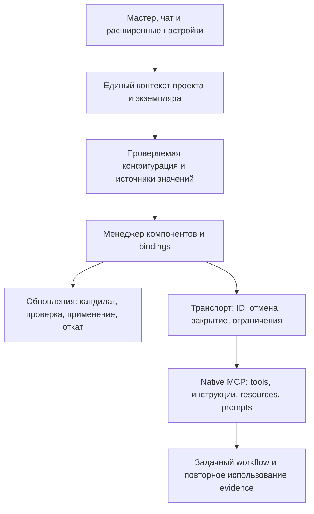

# Ревью готовности 1C AI Core к эксплуатации

> Исторический результат первого прохода. Исправления, повторное ревью и
> актуальные ограничения описаны в [повторном отчёте](2026-10-21-production-followup.md).

Дата: 21 октября 2026 года. Проверена рабочая копия поверх
`b3f4880bdafb05541f1997d40bd947bc3b4e9963`, включая существовавшие незакоммиченные изменения.
Основание выводов — реализация, схемы, воспроизводимые протокольные пробы и исходники
старых harness. Исторические документы не использовались как доказательство поведения.

**Вердикт: выпуск для повседневной эксплуатации пока преждевременен.** Упаковка и
локальные регрессии работают, но ошибки владения состоянием, отмены, жизненного цикла
и обновления затрагивают обычную работу пользователя. Кроме исправления ошибок,
нужна переработка управления компонентами и стоимости нормативного workflow.

Это результат ревью с предложением изменений, а не заявление об исправлении
перечисленных дефектов. Runtime и имевшиеся пользовательские правки в ходе ревью
не изменялись. Созданы этот отчёт и локальные воспроизведения вне состава поставки.

## Критерии продукта

Плагин должен эффективно помогать ИИ разрабатывать 1С, экономить лимиты,
иметь простой основной интерфейс и полноценные настройки для опытного пользователя.
Необязательные компоненты должны отключаться. Подключения, пути и другие переменные
значения задаются настройками. Обновления сторонних компонентов должны быть удобными.
Совместимость проверяется по фактическому контракту; закреплять сторонние версии
или урезать возможности статическими списками инструментов не требуется.

Принятые исключения миграции из `skills/catalog.yaml` учтены:
проектные CRM/Kafka-профили не возвращаются в поставку, HelpSearchServer и SSL-MCP
не восстанавливаются даже как fallback. Готовность их замен оценивается отдельно.

## Проверки и пределы доказательств

| Проверка | Результат |
| --- | --- |
| `node tools/test.mjs` | 190 пройдено, 0 ошибок, 0 пропусков |
| `npm audit --omit=dev --json` | 0 известных уязвимостей runtime-зависимостей по ответу реестра на дату проверки |
| `node tools/vendor.mjs` | Библиотеки и Windows-модули пересобраны; потребовался разрешённый запуск вне ограничений чтения сборщика |
| `node tools/package-plugin.mjs` | Созданы plugin ZIP и marketplace ZIP версии 0.2.1 |
| `node tools/check-plugin.mjs .build/marketplace/plugins/1c-ai-core` | Проверка извлечённого пакета с Node-only PATH пройдена |
| `git diff --check` до добавления отчёта | Ошибок форматирования нет |
| Изолированные пробы relay/runtime | Подтверждения перечислены ниже; использовались фиктивные MCP и локальный HTTP-стенд |
| Реальная разработка через EDT/v8std/BSL/code-index | В рамках этого ревью не выполнялась |
| Реальные лимиты модели и сравнительная скорость задач | Не измерены; проценты экономии не заявляются |

Среда локального исполнения: Windows x64, Node.js 24.20.0. Эти результаты не заменяют
прогон CI-матрицы на других ОС/Node 22 и live-приёмку в целевом Codex.
Аудит npm проверяет известные записи реестра, а не доказывает безопасность всего кода.

Локальное воспроизведение сохранено в
`.work/production-review-2026-10-21/reproduce.mjs`, результаты — в соседнем
`results.json`. Это диагностический стенд для проверенной ревизии: его успешный
выход означает **воспроизведение проблем**, а не прохождение production-тестов.
Он не запускает настоящие EDT, BSL LS или индексатор, не обновляет пользовательские
компоненты и не входит в ZIP.

## Подтверждённые дефекты

### R01 — P1: выбор проекта расходится между настройками и рабочими MCP

Источники: `scripts/lazy_mcp.mjs:67`, `scripts/lazy_mcp.mjs:186`,
`mcp/settings.mjs:35`, `mcp/settings.mjs:323`.

В настройках неподдержанный `roots/list` допускает выбранный каталог запуска.
Relay при таком же ответе оставляет ошибку выбора. Воспроизведено: настройки
успешно показывают профиль, code-index для того же чата остаётся недоступен.

Обратная проблема опаснее: если host не объявляет roots, процесс запущен в корне
плагина, а shared settings содержат старый `active_project`, relay подключается
к сохранённому проекту. Воспроизведён статус `selectedDirectory: null, ready: true`.
Это действительная подстановка чужого binding, а не только устаревший текст UI.

**Изменение:** один resolver контекста для settings, relay и hook. Явное пустое или
неоднозначное выделение не наследует сохранённый проект. Неподдержанные roots и
отсутствующие roots обрабатываются согласованно; cwd плагина не является выбором
пользовательского проекта. Результат resolver должен включать источник выбора.

**Приёмка:** одинаковые root/instance во всех серверах; сценарии отсутствующих,
неподдержанных, пустых, неоднозначных и сменившихся roots; вложенный Git и junction.

### R02 — P1: разные проекты получают одинаковый каталог состояния

Источники: `scripts/project_paths.mjs:57`, `scripts/runtime.mjs:246`,
`scripts/project_context.mjs:124`.

Ключи строятся через лингвистический Unicode casefold. Два реально различных
каталога `Straße` и `STRASSE` на проверенной Windows-системе дают одинаковые
instance directory и project home. На регистрозависимой ФС добавляются обычные
коллизии `Project`/`project`. Коллизия наследует overrides, reconnect-маркеры и
состояние демона. Ownership-проверки демона могут остановить его использование,
но файлы настроек уже разделяют один namespace.

**Изменение:** единая идентичность канонического пути с учётом правил файловой
системы; не применять языковое casefold к путям. В state-записи сохранять полный
root и сверять его при чтении. Нужна миграция существующих ключей с проверкой владельца,
иначе исправление само потеряет сохранённые настройки.

### R03 — P1: обновление code-index оставляет старый демон без штатной остановки

Источники: `scripts/runtime.mjs:203`, `scripts/runtime.mjs:312`,
`scripts/runtime.mjs:597`.

Загрузка нового артефакта сразу заменяет `runtime-lock.json`. Запуск отказывается
переиспользовать старый работающий демон, поскольку executable другой версии.
Но `stop_daemon` тоже отказывается его остановить: executable владельца должен
совпасть с **уже новым** артефактом lock. На локальном HTTP-стенде с корректными
health/PID/root и старым owner воспроизведён `Daemon ownership mismatch`.

Для этого дефекта не требуется изменение интерфейса стороннего индексатора:
достаточно штатного обновления с новым файлом executable.

**Изменение:** разделить скачанный кандидат, активный артефакт и артефакт работающего
процесса. Останавливать процесс по проверенному owner/идентичности процесса и его
собственному executable. Переключать active после проверки кандидата, предусмотреть
откат на предыдущий рабочий артефакт. Читатели и другие проекты учитываются до
перезапуска; глобальная загрузка новой версии не должна ломать старые bindings.

**Приёмка:** обновление при работающих читателях, при несовместимом кандидате,
при ошибке запуска, откат и остановка предыдущей версии. Откат не закрепляет
стороннюю версию навсегда: это сохранение фактического рабочего состояния.

### R04 — P1: отмена запроса не соответствует исполняемой операции

Источники: `scripts/lazy_mcp.mjs:201`, `scripts/lazy_mcp.mjs:349`,
`scripts/mcp_client.mjs:67`, `scripts/remote_client.mjs:205`.

Relay ставит вызовы и уведомления в одну очередь и ждёт полного результата вызова.
`notifications/cancelled` попадает к серверу только после его завершения. Кроме
того, внутренние клиенты назначают свои ID, а notification сохраняет ID хоста.
Стенд подтвердил оба свойства: отмена отсутствует во время исполнения и позже
приходит с ID, отличным от ID отменяемого upstream-вызова.

Та же очередь задерживает обработку roots changes, EOF и shutdown за длительной
операцией. При HTTP-вызове встроенный timeout не восстанавливает семантику отмены.

**Изменение:** отдельный control path для отмены/закрытия и явное соответствие
типизированных host/upstream ID. Serialisation оставлять только там, где её требует
binding или инструмент. Отмена и transport timeout не считаются доказательством
отсутствия mutation; повтор writer по ним по-прежнему запрещён.

**Приёмка:** отмена выполняющегося и ещё не отправленного запроса, параллельные
запросы, string/number ID, смена root и закрытие соединения во время операции.
Проверять всю цепь host → lazy relay → adapter → сервер, а не один BSL proxy.

### R05 — P1: умерший дочерний сервер продолжает считаться готовым

Источники: `scripts/mcp_client.mjs:57`, `scripts/lazy_mcp.mjs:108`,
`scripts/lazy_mcp.mjs:284`.

`McpClient` записывает ошибку завершения, но relay сохраняет объект client и прежнюю
revision. Проверка binding возвращается без переподключения. `ready` вычисляется
как наличие объекта. Воспроизведено: после выхода дочернего MCP статус остаётся
`ready: true`, следующий вызов падает с `MCP exited`.

**Изменение:** явное состояние disconnected/connecting/ready/failed и обработчик
завершения транспорта. Готовность не выводится из ненулевой ссылки. Новый binding
допустим для последующих запросов; прерванный запрос не переигрывается автоматически.
Для BSL повторная регистрация workspace должна быть видимым восстановлением контекста.

### R06 — P1: теряются инструкции живого сервера, необходимые для полного использования MCP

Источники: `scripts/lazy_mcp.mjs:139`, `scripts/lazy_mcp.mjs:242`,
`scripts/lazy_mcp.mjs:291`, `scripts/mcp_client.mjs:94`.

Relay возвращает собственный initialize, а native `initialization.instructions`
сохраняет только внутри клиента. Получить native instructions/capabilities через
status можно лишь для v8std. Для EDT, code-index и BSL LS такой маршрут отсутствует;
BSL получает только добавленную самим плагином инструкцию. Стенд с явной native
instructions подтвердил её отсутствие в initialize и status code-index.

Это особенно мешает цели «полный функционал без привязки к версии»: схема
инструмента не обязана повторять серверные правила сессии, полноты и восстановления.
Также relay объявляет resources/prompts без согласования с реальной поддержкой,
а внутренние клиенты поддерживают лишь ограниченные server-to-client запросы.

**Изменение:** единообразно предоставлять фактический контракт каждого binding
вместе с собственными правилами плагина. Отдельно различать negotiated transport
capabilities и возможности предметных tools. Сохранять названия/schema/results
стороннего сервера; не строить статический каталог вместо него. Неподдержанный
callback нужно объявлять точным ограничением, а не обещать прозрачный relay.

### R07 — P2: несвязанная настройка перезапускает рабочие подключения

Источник: `scripts/lazy_mcp.mjs:99`.

Binding revision включает весь effective config. Изменение URL v8std меняет
revision code-index и BSL LS, хотя эти процессы его не используют. Стенд подтвердил
смену PID code-index reader после единственного изменения v8std URL. Для BSL
тот же путь disconnect уничтожает JVM и её workspace-регистрации. Для индексатора
это теряет историю выдачи читателя и может вызвать повторную передачу данных.

**Изменение:** считать revision по зависимостям конкретного компонента: root,
его параметры, относящиеся к нему mappings и targeted reconnect generation.
Изменение одного URL не сбрасывает весь набор серверов и evidence.

### R08 — P2: валидный JSON неправильной формы аварийно завершает relay

Источник: `scripts/mcp_client.mjs:31`.

Парсер ловит только ошибку JSON.parse. После строки `null` чтение `message.method`
вызывает необработанный TypeError в обработчике stdout. Стенд подтвердил завершение
самого relay. Аналогичная защита нужна для envelope, ID, result/error и размеров
вывода. Сейчас stdio readline не имеет бюджета строки/ответа; в remote-клиенте
бюджет предусмотрен для SSE, но обычный JSON читается целиком.

**Изменение:** общий bounded JSON-RPC codec для transports: проверка envelope,
контролируемое закрытие повреждённого binding и ответ всем pending-запросам.
Transport resource limits отделить от модельного бюджета; допустимые большие
ответы настраиваются, усечение не должно скрываться.

### R09 — P2: контракт совместимости профиля противоречит версии ядра

Источники: `schemas/project-profile.schema.json:448`,
`profiles/generic-1c/profile.yaml`, `scripts/profile.mjs:30`, `plugin.json`.

Ядро имеет версию 0.2.1, но schema разрешает только буквальное
`compatibility.core: '>=0.1.0 <0.2.0'`. Создаваемый профиль объявляет текущее ядро
несовместимым, а validate не проверяет диапазон против версии плагина. Исправить
диапазон в профиле невозможно — schema отвергнет любое другое значение.

**Изменение:** различать версию формата профиля и совместимость с ядром; валидировать
поддерживаемую семантику диапазона, а затем реальную совместимость. Не размножать
версию ядра по независимым константам и не путать это с версиями внешних компонентов.

### R10 — P2: подготовка с согласованием и автоматическое подключение имеют разные правила эффектов

Источники: `scripts/settings_backend.mjs:65`, `scripts/settings_backend.mjs:516`,
`scripts/lazy_mcp.mjs:123`, `scripts/lazy_mcp.mjs:367`, `scripts/managed_mcp.mjs:8`.

`settings.run_check` требует разрешение запуска. Но initialize/idle refresh relay
может пройти через managed entrypoint, скачать артефакт и запустить сервис без
этого действия. Стенд подтвердил автоматический старт фиктивного managed-сервиса
после появления профиля без вызова подготовки. Прямая цепь до загрузки/старта
подтверждается `launch_command`/`ensure_installed`.

Это не основание добавлять постоянные вопросы пользователю. Следует один раз
определить продуктовую семантику: явное первоначальное включение компонента
разрешает дальнейшие штатные старты в том же scope, а отображение/валидация профиля
остаётся чтением. До включения виден статус «не подготовлен». Существующее
согласование переиспользуется; обновление/очистка с дополнительными эффектами
отдельно отображает план. Альтернатива — открыто заявить автоматическую подготовку
при включении плагина и привести остальные интерфейсы/политику к этому контракту.

## Расхождения с целями продукта и изменения подхода

### A01 — управление компонентами сейчас жёсткое и не даёт отключить необязательное

Источники: `schemas/plugin-settings.schema.json:76`, `scripts/lazy_mcp.mjs:28`,
`scripts/settings_backend.mjs:522`, `scripts/doctor.mjs:70`, `mcp.json`.

Оба managed-компонента обязательны, их `mode` разрешает только `auto`.
Отключить BSL LS или задать внешний экземпляр нельзя. Подготовка проверяет оба
компонента независимо от потребности. В навыках BSL LS требуется лишь для
отдельного focused-вопроса, поэтому требование его общей готовности и Java
ухудшает простой пользовательский сценарий без пользы для многих задач.

Для добавления ещё одного компонента нужно менять несколько списков и branches:
manifest, schema, SPECS/asset selection, relay, settings preparation, doctor,
представление/иконки. Это расширяемость исходников, но ещё не устойчивый контракт
расширений.

**Предложение:** общий descriptor/provider API: ID, способ запуска, схема настроек,
проверка контракта, lifecycle/update adapter и dependencies. Включение независимо
от режима managed/external. Набор capabilities определяется живым сервером.
Профиль выбирает необходимые маршруты; отключённый BSL не мешает работе через EDT.
Базовые guards и concurrency checks не становятся необязательными вместе с анализатором.
Descriptor не должен превращаться в разрешение исполнять произвольные команды
из непроверенного переносимого профиля.

### A02 — `latest` и `refresh` не образуют пользовательский сценарий обновления

Источники: `scripts/runtime.mjs:110`, `scripts/runtime.mjs:120`,
`mcp/settings.mjs:304`, `ui/settings.html:241`.

При существующем артефакте `version: latest` возвращает его без запроса новых
releases. В UI есть «Подготовить и проверить», но он не передаёт refresh; отдельной
проверки обновлений/обновления выбранного компонента нет. `refresh` одновременно
выполняет download и запускает проверки, а его описание предлагает использовать
его главным образом для несовместимого кеша. Пользователь не получает простой
путь «есть новая версия → проверить → применить → откатить».

**Предложение:** разделить операции `проверить обновления`, `скачать кандидат`,
`проверить совместимость`, `применить`, `откатить`. Проверка обновлений доступна
без ИИ и не перезапускает сервисы. Управление из чата и формы использует один backend.
По умолчанию предлагается актуальный стабильный upstream release; предыдущее
рабочее состояние сохраняется для отката. Источник, digest и фактически запущенный
артефакт отображаются отдельно. Для нескольких проектов обновляется кандидат,
а существующие сессии переключаются управляемо.

Версия релиза служит provenance и идентификатором артефакта, а не allowlist
поддерживаемых возможностей. Compatibility gate проверяет нужный контракт.
Жёсткую проверку Java 25 в `scripts/runtime.mjs:411` следует привязать к требованиям
выбранного JAR/его запуску и дать корректную диагностику. Нельзя считать любое
будущее latest-обновление совместимым только потому, что есть Java 25.

### A03 — экономия лимитов описана, но дорогой workflow не измеряется

Источники: `policy/detector.mjs:3`, `policy/selector.mjs:111`,
`policy/selector.mjs:192`, `skills/1c-standards/references/requirements.md`.

Для oneC selection нужны оценки всех 18 critical mechanisms, включая отсутствие.
Полный detection передаётся при selection и снова в current для compliance;
selection/ledger тоже передаются целиком. Для M/H до и после записи предусмотрены
отдельные оценки. Checker проверяет согласованность заявлений агента и не читает
source или нормы; самостоятельная проверка содержания всё равно остаётся агенту.
Это полезная формальная проверка, но её цена не должна приниматься за бесплатную.

Измеренный размер двух основных документов пути изменения:

| Текст, символы с переводами строк | Kafka harness | Текущий плагин |
| --- | ---: | ---: |
| `1c-code-change/SKILL.md` | 4 782 | 9 757 |
| Общий requirements workflow | 3 055 | 12 303 |
| Сумма этих двух файлов | 7 837 | 22 060 |

Это примерно 2,8 раза больше символов, **не измерение billed tokens**. Документы
различаются языком и содержанием, могут загружаться постепенно, а host может
использовать caching/deferred tools. Рост не доказывает ухудшение качества или
конкретный перерасход лимита, но обосновывает обязательный benchmark.

**Предложение:** краткий entry workflow и progressive references; хранить scoped
selection/evidence один раз с идентификатором/ревизией и передавать изменения.
Объединить чисто механические normalize/select/validate обращения там, где это
не смешивает предложение с фактическим результатом. Сохранить guards, проверку
фактического результата и нужную строгость норм. Режим подробного формального
ledger можно делать настройкой проекта; упрощение формы отчёта не разрешает
пропуск содержательной проверки обязательных норм.

Нужны одинаковые реальные задачи в старом harness и плагине: поиск, маленькая
правка, metadata change, запрос, YaXUnit, UI-сценарий. Измерять вход/выход модели,
повторно полученные данные, число вызовов/ошибок и время до проверенного результата,
при одинаковых модели и критериях качества. Сокращение числа вызовов само по себе
не означает экономию, если ответы стали большими.

Полный `tools/list` также сам по себе не доказывает расход модельных лимитов.
Сначала следует проверить поведение host. Удалять native tools ради красивой
метрики нельзя; следует использовать server-side toolsets, deferred discovery,
точные секции и адресные ответы с сохранением доступности полного функционала.

### A04 — перенос полезного механизма старого harness не должен сводиться к переносу текста

Изучены реальные исходники CRM harness на revision
`706d678b8cf321602716ab80c1020a3b4d28bdf8` и Kafka tools на revision
`0517450e1135dec9ab7c89bf06dcef089a33bc07`. Текущий Kafka checkout отличается от
наблюдаемой revision каталога миграции; выводы основаны на прочитанных файлах.
Локальные изменения источников отдельно не атрибутировались, поэтому нельзя
считать каждый прочитанный байт содержимым только указанного коммита.

| Опыт старого harness | Что сохранить и как проверить в ядре |
| --- | --- |
| Один факт — одна primary authority; проверяются только нужные endpoints | Не делать общую readiness всех сервисов prerequisite простого чтения |
| Reuse-gate: 1–3 термина, до пяти релевантных кандидатов, остановка на достаточном | Сохранить в навыке; проверить на реальных задачах отсутствие дублирующего EDT discovery |
| Точный alias и scope, кешируемая проверка readiness перед code-index calls | В старом `mcp/code-index-proxy.mjs` это реализовано в `requireReadyRepository`; новый relay безусловно forwards calls. Проверить, что соответствующий invariant обеспечивает native сервер или плагин |
| BSL-aware callers/callees/path вместо менее точного universal graph | Старый proxy добавлял специализированные инструменты. Новый код рассчитывает на native MCP: проверить фактическое coverage, не возвращать SQL-обёртки только ради совпадения имён |
| Нативные batches и bounded replies | Сохранять схемы и results, учитывать partial/omitted/dedup markers; не читать все страницы предметных данных автоматически |
| BSL LS только для отдельной нужды | Сделать компонент отключаемым; общий setup не требует его готовности |
| Guarded EDT mutation и неизвестный исход без retry | Сохранить как обязательные гарантии; исправить transport cancellation, не ослабляя правило unknown outcome |
| OpenViking в Kafka имел реальный read-only Git-context маршрут | В ядре сейчас только reserved settings/план. Это явно неперенесённая capability, но не основание восстанавливать исключённые SSL/Help servers |

Стенд подтвердил передачу неизвестного profile alias через новый relay. Это
доказывает отсутствие проверки **в relay**, но не доказывает чтение чужого проекта
на реальном code-index: собственная проверка native сервера и host hook в этой
пробе не принимались. Приёмка должна установить один реальный владеющий этим
invariant слой, а не дублировать одинаковые health-запросы перед каждым чтением.

### A05 — расширенные настройки нужны как устойчивый API, а не только текстовый редактор

Существующие preview/revision/rollback, отдельные instance overrides и источники
значений — хорошая основа. Однако внешний EDT/v8std relay принимает только URL:
schema не даёт настроить auth headers/token env, timeout или transport limits.
Настройки ручного HTTP-клиента Vanessa уже содержат похожие возможности, но общий
relay их не переиспользует. Это ограничивает защищённые внешние подключения.

Нужен общий тип connection settings: endpoint, ссылки на env credentials,
пределы ожидания/ответа, source/provenance. Секреты не включаются в экспорт.
Профи редактирует тот же проверяемый документ, который формирует простой мастер;
значения не размножаются по UI, schema и runtime. Сложные настройки раскрываются
по необходимости, а отсутствие обычного заполненного поля объясняется его источником.

## Рекомендуемая архитектура изменений

Полная перепись всех навыков не нужна. Наиболее полезна замена общего слоя
binding/lifecycle/update с сохранением проверенных кодеков, guard-проверок,
переносимых профилей, native tool schemas и предметных workflow.

Менеджер должен различать состояния: отключён, не настроен, не подготовлен,
скачивается, запускается, подключён, частично готов, ошибка, обновление доступно.
Готовность привязана к операции и слоям данных, а не к наличию client object.
Общий index daemon и session-owned BSL JVM сохраняют разные lifecycle-контракты.

Фоновое наблюдение за изменением профиля не должно запускать скачивание лишь от
просмотра настроек. Опрос файлов сам по себе не тратит модельные токены; его
следует оптимизировать ради I/O/CPU и предсказуемости. Для экономии лимитов важнее
не сбрасывать рабочие bindings и не заставлять агента повторять discovery.

## Порядок доведения и критерии выпуска

1. Исправить R01–R06: контекст, идентичность, безопасное обновление/остановка,
   ID/отмена, смерть процесса, сохранение native contract. Перенести обнаруженные
   сценарии в регрессии с ожиданием исправленного поведения.
2. Исправить R07–R10: targeted invalidation, codec, профильная совместимость,
   единая семантика первоначального включения. Проверить весь путь из Codex,
   включая смену root и закрытие чата при работающем запросе.
3. Реализовать A01/A02: отключаемые компоненты, общий provider/lifecycle API,
   понятные обновления с проверкой живого контракта и откатом. Не закреплять
   release-версии и не фильтровать native функционал статическим allowlist.
4. Провести A03 benchmark и сократить измеренный процедурный overhead. Сохранить
   качество решения, concurrency guards, нормативные требования и диагностику;
   отдельно измерять цену переиспользования evidence и ошибок восстановления.
5. Закрыть live coverage A04 и расширенные подключения A05. Для clean install,
   первого проекта, параллельных проектов, отключённого BSL, обновления,
   несовместимого кандидата и отката получить подтверждённые результаты в Codex.

Выпуск допустим после исправления подтверждённых P1, устранения продуктового
расхождения по отключению/обновлению компонентов и live-приёмки основных маршрутов.
Число unit tests, корректный ZIP и зелёная синтетическая проверка сами по себе
не доказывают достижение этих условий.
